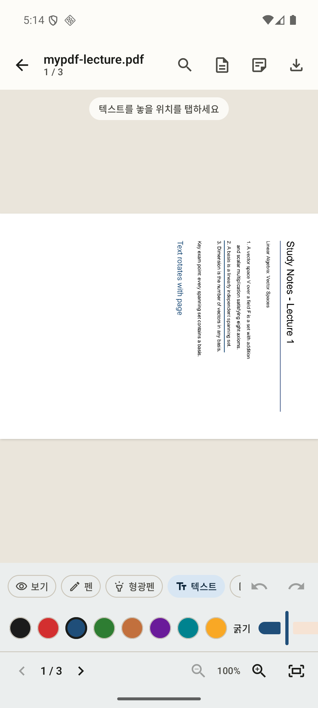
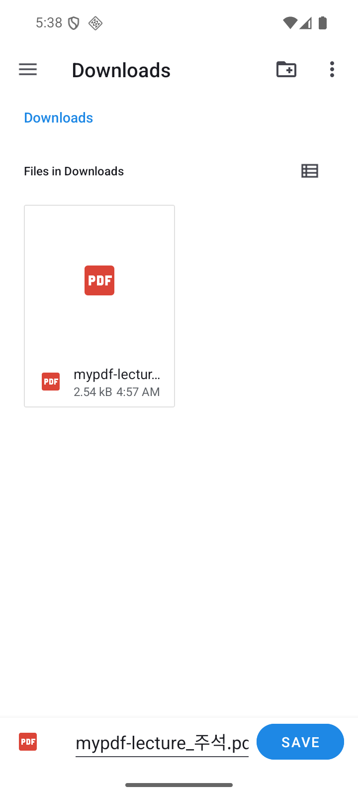

# My PDF Writer

> 전공 공부를 위한 오프라인 PDF 필기·편집 앱

강의자료 PDF 위에 바로 필기하고, 페이지를 정리하고, 주석이 새겨진 PDF로 내보내는 Android 앱입니다.
광고·계정·인터넷 권한 없이 **기기 안에서만** 동작합니다.

- **패키지**: `com.hackerdjakodjo.mypdfwriter`
- **버전**: `0.1.0` (개발 빌드)
- **지원 OS**: Android 8.0 (API 26) 이상
- **타깃 SDK**: 36 (Android 16)

---

## 왜 만들었나

PDF 리더·편집기는 이미 넘쳐나지만, 대학생이 **전공 강의자료를 공부하는 흐름**에 맞춘 앱은 드뭅니다.
대부분은 스캐너·변환기·광고 수익 모델이 앞세워져 있고, 정작 강의자료 위에 빠르게 필기하고
페이지를 정리해 다시 PDF로 내보내는 일은 여러 앱을 오가야 합니다.

My PDF Writer는 다음 한 가지에 집중합니다.

> **"강의자료를 열고 → 표시하고 → 정리하고 → 주석이 새겨진 PDF로 바로 내보낸다."**

---

## 주요 기능

| 영역 | 기능 |
| --- | --- |
| 필기 | 펜, 형광펜(반투명), 텍스트, 사각형, 화살표, 지우개 |
| 스타일 | 8색 팔레트, 펜·도형 굵기, 텍스트 크기 |
| 편집 | 실행 취소 / 다시 실행 (최대 60단계) |
| 페이지 | 왼쪽·오른쪽 회전, 위·아래 이동, 삭제, 빈 페이지 추가, 원본 구성으로 초기화 |
| 메모 | 페이지별 공부 메모, 메모가 있는 페이지 목록 |
| 검색 | PDF 텍스트 검색, 페이지별 결과 수·스니펫, 해당 페이지로 이동 |
| 내보내기 | 화면과 동일한 렌더러로 주석을 평탄화(flatten)해 PDF 저장 |
| 파일 | SAF로 열기/저장, 최근 문서 목록, 다른 앱에서 PDF 열기(`ACTION_VIEW`) |
| UI | 한국어, 라이트/다크 테마, 엣지투엣지 |

### 설계 포인트

- **완전 오프라인**: `INTERNET` 권한 자체를 선언하지 않습니다. 광고·분석·계정 SDK도 없습니다.
- **WYSIWYG 내보내기**: 화면 필기와 내보내기가 **같은 `AnnotationPainter`** 를 사용합니다.
  한국어 텍스트, 형광펜 투명도, 펜 곡선이 PDF 뷰어에서도 동일하게 보입니다.
- **회전해도 필기가 따라감**: 페이지를 회전하면 필기 좌표·굵기·글자 크기·텍스트 방향을 함께 보정합니다.
- **원본 보존**: 원본 PDF는 앱 저장소에 복사해 두고, 페이지 구성은 `PageSpec` 목록으로 관리합니다.
  작업용 PDF는 페이지 작업 때마다 원본에서 다시 조립합니다.

---

## 스크린샷

| 홈 | 필기 | 페이지 편집 |
| --- | --- | --- |
|  |  |  |

| 회전된 페이지 | 도형 | 형광펜 |
| --- | --- | --- |
|  |  |  |

| 페이지 메모 | 검색 | 빈 페이지 |
| --- | --- | --- |
|  |  |  |

| 초기화 | 내보내기 | 내보낸 PDF 열기 |
| --- | --- | --- |
|  |  |  |

> Pixel 7 AVD(Android 16)에서 720×1600으로 캡처했습니다. 화면의 문서는 테스트용 샘플 PDF입니다.

---

## 사용 흐름

1. 홈에서 **PDF 열기**로 강의자료를 선택하거나, **빈 PDF**로 새 문서를 만듭니다.
2. 아래 도구 모음에서 펜·형광펜·텍스트·도형·지우개를 고릅니다.
3. 색과 굵기를 고르고 페이지 위에 직접 표시합니다.
4. 필요하면 **페이지** 시트에서 회전·순서·삭제·빈 페이지를 정리합니다.
5. **메모**로 페이지별 공부 메모를 남기고, **검색**으로 키워드를 찾습니다.
6. **내보내기**로 `원본이름_주석.pdf`를 저장합니다. 주석은 PDF에 평탄화되어 어디서나 동일하게 보입니다.

---

## 기술 스택

| 구분 | 사용 기술 |
| --- | --- |
| 언어 | Kotlin 2.2.21 |
| UI | Jetpack Compose (BOM 2025.12.01, Material 3) |
| 빌드 | AGP 8.13.2, Gradle 8.13, JDK 17 |
| PDF 읽기/조립 | PDFBox-Android 2.0.27.0 |
| PDF 화면 렌더링 | `android.graphics.pdf.PdfRenderer` |
| 상태 관리 | `ViewModel` + `StateFlow` (단일 모듈, Navigation/Room/Hilt 미사용) |
| 저장 | `org.json` 기반 JSON 파일 + `SharedPreferences` |
| 파일 접근 | Storage Access Framework (`ActivityResultContracts`) |

**빌드 크기**: 디버그 APK 약 28 MB, 릴리스 APK **7.9 MB**, AAB **10.5 MB** (R8 코드 축소 + 리소스 축소 적용).

---

## 아키텍처

```
[홈 / 라이브러리]
      │ SAF OpenDocument
      ▼
[PdfViewModel] ── 원본 PDF 복사 ──▶ files/sources/<docId>.pdf
      │                                  │
      │ PageSpec 목록                    │ assemble()
      ▼                                  ▼
[작업용 PDF] ◀──────────────── cache/working/<docId>.pdf
      │ PdfRenderer
      ▼
[페이지 비트맵] + [AnnotationPainter 오버레이]
      │
      ├─ 필기/도형/텍스트 → Annotation(정규화 좌표) → docstates/<docId>.json
      └─ 내보내기 → PdfExporter(2x 래스터 + 회전 행렬) → SAF 저장
```

- 좌표는 페이지 표시 영역 기준 **0.0~1.0 정규화 좌표**로 저장합니다.
- 페이지 작업(회전·이동·삭제·빈 페이지)은 `PageSpec`만 바꾸고 작업용 PDF를 다시 조립합니다.
- 자세한 설계와 회전 보정 수식은 [`docs/architecture.md`](docs/architecture.md)를 참고하세요.

---

## 빌드 및 실행

### 요구 사항

- JDK 17
- Android SDK Platform 36, Build-Tools 36
- Android Studio (권장) 또는 커맨드라인

### 로컬 빌드

```bash
# 1) 저장소 클론
git clone https://github.com/hackerdjaKODJO/my-pdf-writer.git
cd my-pdf-writer

# 2) SDK 경로 지정 (local.properties는 커밋되지 않습니다)
#    Windows 예: sdk.dir=C\:\\Users\\<user>\\AppData\\Local\\Android\\Sdk
#    macOS/Linux 예: sdk.dir=/Users/<user>/Library/Android/sdk

# 3) 디버그 빌드
./gradlew assembleDebug          # Windows: gradlew.bat assembleDebug

# 4) 설치
adb install -r app/build/outputs/apk/debug/app-debug.apk
```

디버그 빌드는 `applicationIdSuffix = ".debug"`가 붙어
`com.hackerdjakodjo.mypdfwriter.debug`로 설치됩니다.

### 릴리스 빌드

R8 코드 축소와 리소스 축소가 켜져 있습니다(`app/build.gradle.kts`).
PDFBox-Android의 선택적 클래스에 대한 keep/dontwarn 규칙은 `app/proguard-rules.pro`에 있습니다.
업로드 키스토어와 `keystore.properties`는 저장소에 커밋하지 않습니다.

```bash
# 새 환경에서 업로드 키 생성 (비밀번호는 안전한 곳에 보관)
keytool -genkeypair -v -keystore upload-keystore.jks -storetype PKCS12 \
  -alias upload -keyalg RSA -keysize 2048 -validity 10000

# keystore.properties
# storeFile=upload-keystore.jks
# storePassword=...
# keyAlias=upload
# keyPassword=...

./gradlew bundleRelease assembleRelease
# app/build/outputs/bundle/release/app-release.aab
# app/build/outputs/apk/release/app-release.apk
```

릴리스 APK는 `com.hackerdjakodjo.mypdfwriter`(디버그 접미사 없음)로 설치됩니다.

---

## 검증 기록

Android 16(Pixel 7 AVD)에서 다음 흐름을 직접 확인했습니다.

- PDF 열기, 최근 문서 등록/제거, 빈 PDF 생성
- 펜·형광펜·텍스트·사각형·화살표·지우개, 색/굵기 변경
- 실행 취소/다시 실행
- 페이지 회전(90°/180°), 이동, 삭제, 빈 페이지 추가, 원본 구성 초기화
- 회전된 페이지에서 텍스트·밑줄·형광펜이 함께 회전
- 페이지 메모 저장/불러오기, 텍스트 검색(2건) 및 페이지 이동
- 디버그 내보내기: `mypdf-lecture_주석.pdf` (24,982 bytes)
  - `pdfinfo`: 3 pages, A4, Page rot 90
  - Poppler 렌더링으로 평탄화된 필기·형광펜·밑줄 확인
  - 내보낸 PDF를 앱에서 다시 열어 편집 가능한 주석이 없음을 확인
- **R8 릴리스 APK**에서 PDF 열기, 펜, 검색(2건), 페이지 회전, 내보내기 재검증
  - `release-r8-test.pdf` (14,545 bytes), `pdfinfo`: 3 pages, A4, Page rot 90
- **단위 테스트 11개 통과** (`PageSpec` 회전 정규화, `PageTransforms` 90/180/270 변환,
  `DocState.normalized` 인덱스 재매핑)
- 릴리스 APK 권한 확인: `INTERNET`/저장소/카메라/알림/광고 ID 없음
- 네이티브 라이브러리 16 KB 페이지 정렬 확인 (`zipalign -c -P 16`)

> 계측(UI) 테스트는 아직 없습니다. 위 항목은 에뮬레이터 수동 스모크 테스트와 JVM 단위 테스트 결과입니다.

---

## 개인정보와 권한

- `INTERNET` 권한을 **선언하지 않습니다**. 문서와 필기가 기기 밖으로 나가지 않습니다.
- 광고·분석·계정 SDK가 없습니다.
- 파일은 SAF로 사용자가 직접 선택한 PDF만 읽고, 앱 전용 저장소에 복사합니다.
- 필기·페이지 구성·메모는 앱 전용 JSON(`files/docstates/`)에 저장됩니다.
- 최근 문서 목록은 `SharedPreferences`에 최대 40개까지 저장됩니다.
- 앱을 삭제하면 앱 전용 데이터도 함께 삭제됩니다. (원본 PDF는 삭제되지 않습니다.)
- 개인정보 처리방침: <https://hackerdjakodjo.github.io/my-pdf-writer/privacy-policy.html>

---

## 프로젝트 구조

```
app/src/main/java/com/hackerdjakodjo/mypdfwriter/
├── MainActivity.kt              # SAF 런처, ACTION_VIEW, 홈/뷰어 전환
├── MyPdfWriterApp.kt            # PDFBox 리소스 초기화
├── data/
│   ├── Models.kt                # Annotation, PageSpec, DocState, RecentDoc
│   ├── PageTransforms.kt        # 회전 시 좌표/굵기/글자 크기 보정 (순수 함수)
│   └── Stores.kt                # DocStateStore(JSON), LibraryStore(SharedPreferences)
├── pdf/
│   ├── PdfRepository.kt         # 원본 복사, 페이지 조립, PdfRenderer 캐시, 텍스트 추출
│   ├── AnnotationPainter.kt     # 화면/내보내기 공용 페인터
│   └── PdfExporter.kt           # 주석 평탄화 + 회전 행렬
└── ui/
    ├── LibraryScreen.kt         # 홈, 최근 문서, 기능 소개
    ├── ViewerScreen.kt          # 뷰어 상단/하단 바, 도구 모음
    ├── ViewerSheets.kt          # 페이지/메모/검색 시트, 텍스트 입력
    ├── PdfCanvas.kt             # 제스처, 좌표 변환, 실시간 미리보기
    ├── PdfViewModel.kt          # 상태, 페이지 작업, 실행 취소, 검색, 내보내기
    └── theme/Theme.kt
app/src/test/java/com/hackerdjakodjo/mypdfwriter/data/
├── PageSpecTest.kt              # 회전 정규화
├── PageTransformsTest.kt        # 90/180/270 좌표·스케일 변환
└── DocStateTest.kt              # 원본 변경 시 페이지/주석/메모 재매핑
```

기타:

- `tools/make-sample-pdf.js`, `tools/mypdf-lecture.pdf` — 테스트용 3페이지 샘플
- `tools/make-store-assets.py` — Play Store 스크린샷/피처 그래픽/아이콘 생성
- `store/` — Play Store 등록용 1080×2160 스크린샷 7장, 피처 그래픽, 512px 아이콘
- `docs/screenshots/` — 기능 검증 스크린샷
- `docs/competitive-analysis.md` — 경쟁 앱 5종 역공학 분석
- `docs/architecture.md` — 상세 설계
- `docs/play-store-roadmap.md` — Play Store 출시 로드맵

---

## Play Store 자산

`store/`에 Play Store 등록용 자산과 문안을 준비했습니다.

- `store/screenshots/` — 1080×2160 스크린샷 7장 (1:2 비율)
- `store/feature-graphic-1024x500.png` — 피처 그래픽
- `store/icon-512.png` — 앱 아이콘
- `store/README.md` — 앱 이름/설명, 데이터 안전성 답변, 업로드 체크리스트

`python tools/make-store-assets.py`로 언제든 다시 생성할 수 있습니다.

---

## 로드맵

- **v0.1 (현재)**: 핵심 필기·페이지 편집·메모·검색·평탄화 내보내기, R8 릴리스 빌드/AAB,
  업로드 키스토어, 단위 테스트 11개, Play Store 자산
- **v0.2**: Play Console 등록·테스트 트랙, 페이지 썸네일, 텍스트 선택·복사, 이미지 삽입, 태블릿 레이아웃
- **v0.3**: 스캔 PDF OCR, 암호화 PDF, 폼 필드, 접근성 개선
- **v1.0**: Play Store 정식 출시, 영어/일본어, 온보딩

자세한 출시 체크리스트는 [`docs/play-store-roadmap.md`](docs/play-store-roadmap.md)를 참고하세요.

---

## 라이선스

아직 별도 라이선스 파일이 없습니다. 외부 배포 전에 결정이 필요합니다.
사용한 오픈소스 라이브러리의 라이선스(Compose, PDFBox-Android 등)는 각 프로젝트를 따릅니다.
