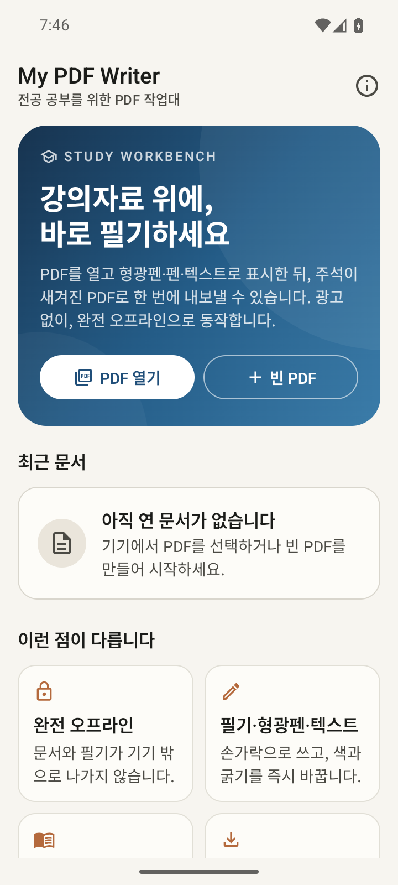
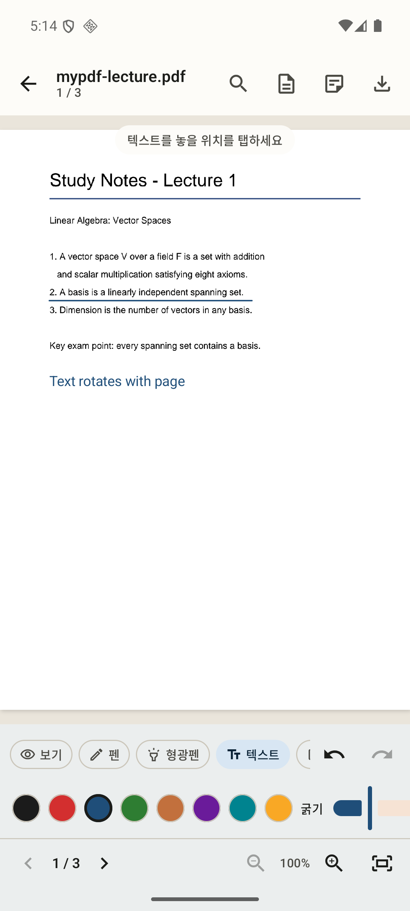
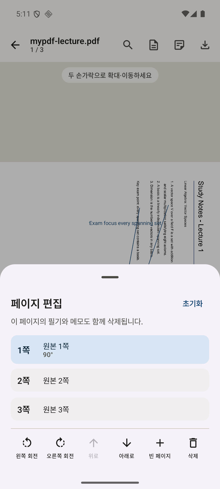
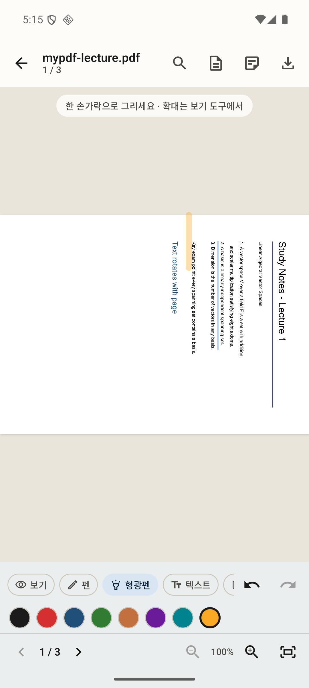
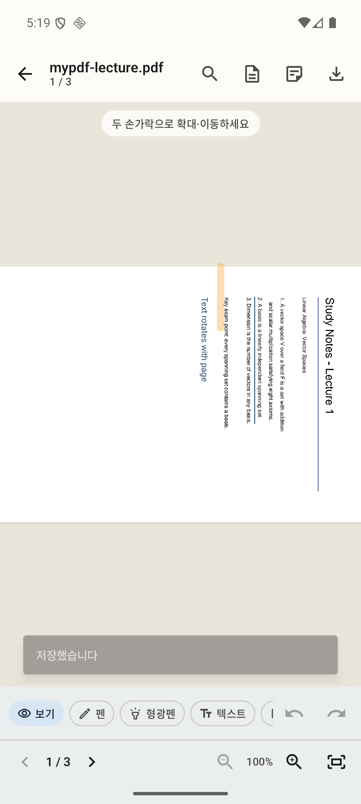
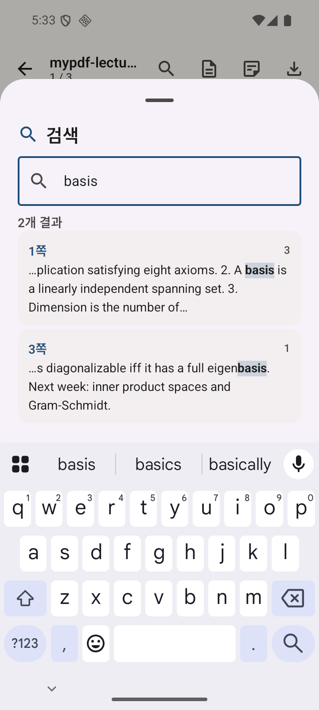

# My PDF Writer

> 전공 공부를 위한 오프라인 PDF 필기·편집 앱

강의자료 PDF 위에 바로 필기하고, 페이지를 정리하고, 주석이 새겨진 PDF로 내보내는 Android 앱입니다.
광고·계정·인터넷 권한 없이 **기기 안에서만** 동작합니다.

- **패키지**: `com.hackerdjakodjo.mypdfwriter`
- **버전**: `0.8.87` (개발 빌드)
- **지원 OS**: Android 8.0 (API 26) 이상
- **타깃 SDK**: 36 (Android 16)
- **PC 인계 문서**: [`HANDOFF.md`](HANDOFF.md)
- **사용법 HTML**: [`docs/usage-guide.html`](docs/usage-guide.html)
- **E2E 테스트 케이스**: [`docs/e2e-test-cases.md`](docs/e2e-test-cases.md)

---

## 왜 만들었나

PDF 리더·편집기는 이미 넘쳐나지만, 대학생이 **전공 강의자료를 공부하는 흐름**에 맞춘 앱은 드뭅니다.
대부분은 스캐너·변환기·광고 수익 모델이 앞세워져 있고, 정작 강의자료 위에 빠르게 필기하고
페이지를 정리해 다시 PDF로 내보내는 일은 여러 앱을 오가야 합니다.

My PDF Writer는 다음 한 가지에 집중합니다.

> **"강의자료를 열고 → 표시하고 → 정리하고 → 주석이 새겨진 PDF로 바로 내보낸다."**

---

## 주요 기능

| 영역 | 기능 |
| --- | --- |
| 노트 홈 | 이어서 읽기/쓰기 카드, **항상 보이는 만들기 FAB**, **필터/정렬/보기 한 줄 도구 모음**, **통합 설정 시트(백업·휴지통·태그·PDF 도구·도움말)**, PDF 탭 최근 문서 우선, 태그 검색, StarNote 스타일 라이브러리, 열고 돌아와도 탭·필터 유지 |
| 노트북 | 11종 종이 템플릿, 템플릿 스튜디오(A4 세로/가로·종이색·표지), **커스텀 이미지/PDF 1페이지 배경**, 커버 색/패턴 |
| 노트 편집 | 필기 보정, 도형 자동 인식, 부분 지우개, 선택 이동·확대·회전·복사/붙여넣기, **포스트잇(이동·크기·색상·최소화)**, **즐겨찾는 펜 슬롯**, PDF 패널용 컴팩트 도구 독, 스타일 시트, undo/redo |
| 입력 방식 | 스타일러스 필기 + 손가락 이동/확대, **펜별 필압 반응(굵기·잉크 농도·붓 번짐·연필 진하기)**, 필압 반응 곡선, 두 손가락 탭 undo/세 손가락 탭 redo, 손가락 필기, 줌 잠금 |
| 펜 | **펜(볼펜) 건조 스킵·만년필 닙 테이퍼·연필 흑연 입자** 등 펜별 필압 반응, 펜박스 프리셋 저장/적용/이름변경, 최대 6개 즐겨찾는 펜 등록·순서변경·원터치 적용 |
| 선택 | 자유/사각 선택, 선택 삭제·복제·색 변경, 이동·확대·회전·복사/붙여넣기 |
| 레이어 | 페이지별 레이어 추가·이름변경·숨김·잠금·투명도·순서 |
| 페이지 | 페이지 관리 필터(전체/필기)·다중 선택 복제/삭제·**회전**, **사진 페이지/현재 페이지 사진 배경**, 추가·순서 이동, 내보내기 프리셋 |
| 북마크 | 페이지 아웃라인, 페이지 북마크 추가·이름변경·이동·삭제 |
| 읽기 모드 | 단일 페이지, **핀치 확대 시 페이지 비트맵도 재렌더링되는 연속 보기**, 2/4페이지 스프레드, 팝업, 진행률 복원, 문서별 야간 모드·밝기 유지, 페이지 잠금, 내부 PDF 링크 이동, **상단 검색·6슬롯 독·그룹형 PDF 메뉴** |
| Reflow | PDF 텍스트를 화면 폭에 재배치, 글자 크기·줄 간격·종이/세피아/다크, 텍스트 선택·복사 |
| 읽어주기 | 시스템 TTS로 페이지 읽기, 속도·한국어/English, 페이지 자동 넘김 |
| 텍스트 선택 | PDF 캔버스에서 탭/드래그/길게 눌러 단어 선택, **형광펜·밑줄·취소선·복사·발췌 우선**, 번역·사전·패널 추가는 더보기 |
| 발췌·번역 | PDF 발췌 저장, 발췌 목록/페이지 이동, **Google 번역** 앱/웹으로 바로 열기, 공유 |
| 스터디 노트 | 발췌를 원본 PDF 페이지 링크가 있는 노트북으로 만들기, **PDF 위 85% 집중 스터디 패널·발췌 드롭 캡처·To/From 링크**, **28dp 중앙 드래그 구분선·크기 프리셋·PDF/노트 도구 표시 전환** |
| 가리기 카드 | 노트 **메뉴 → 카드 → 가리기 카드**: 질문/정답 카드 만들기, 페이지 위 테이프에서 탭으로 정답 확인·O/X 채점, 전체 진행률/정답률, 오프라인 JSON·백업 저장 |
| 오디오 노트 | 로컬 녹음·재생, 페이지 마커 추가/이동 |
| 오디오 재생 | 필기 리플레이, **0.5x~2x 재생 속도**, 페이지 마커·타임라인 |
| 로컬 백업 | 노트북·필기·발췌·읽기 진행률·오디오를 ZIP으로 백업/복원, PDF 원본 포함 선택 |
| 필기 | 펜, 형광펜, 텍스트, 사각형, 화살표, 선, 타원, 밑줄, 취소선, 지우개 |
| 스탬프 | APPROVED / DRAFT / CONFIDENTIAL / REVIEWED / 사용자 문구 |
| 서명 | 손글씨 느낌의 서명 텍스트를 페이지에 배치 |
| 가림 | REDACT 검은 박스. 내보낼 때 해당 페이지를 래스터화해 원본 텍스트도 제거 |
| 스타일 | 8색 팔레트, 굵기·글자 크기·투명도 |
| 편집 | 실행 취소 / 다시 실행 (필기와 페이지 작업, 최대 60단계) |
| 페이지 | 썸네일 그리드, 다중 선택, 회전·삭제·복제·이동·빈 페이지·추출 |
| 문서 도구 | PDF 합치기, N쪽마다 분할, 이미지→PDF, PDF→PNG, 텍스트 추출, 최적화 |
| OCR | 한국어/English 온디바이스 OCR, 텍스트 추출, 보이지 않는 텍스트 레이어가 있는 검색 가능한 PDF |
| 보안·정보 | 문서 정보 편집, 열기 암호 설정/해제, 워터마크, 페이지 번호 |
| 읽기 | 목차(북마크), 문서 정보, 야간 모드, 현재 페이지 텍스트 복사, 주석 숨김/필터 패널 |
| 양식 | AcroForm 텍스트·체크박스·라디오·목록 필드 채우기 |
| 메모 | 페이지별 공부 메모, 메모가 있는 페이지 목록 |
| 검색 | PDF 텍스트 검색, 페이지별 결과 수·스니펫, 해당 페이지로 이동, 페이지 위 검색어 하이라이트, **노트 메모/텍스트/스탬프/서명 검색** |
| 내보내기 | 화면과 동일한 렌더러로 주석·워터마크·페이지 번호를 평탄화해 PDF 저장, 노트 전체/현재/선택 페이지 프리셋, **포스트잇 포함** |
| 공유·인쇄 | Android 공유 시트와 인쇄 프레임워크 |
| 파일 | SAF로 열기/저장, 최근 문서 목록, 다른 앱에서 PDF 열기(`ACTION_VIEW`), **다른 앱에서 공유한 PDF 바로 가져오기(`ACTION_SEND`)** |
| UI | 한국어, 라이트/다크, 엣지투엣지, **접근성 정책(48dp 터치·상태 라벨·큰 글자 레이아웃)**, 홈 필터·설정 시트, PDF 6슬롯 독·그룹형 메뉴, 노트 메뉴 10행, 앱 내 도움말, PDF+노트 플로팅 크롬·경계 드래그 |

### 설계 포인트

- **완전 오프라인**: `INTERNET` 권한 자체를 선언하지 않습니다. 광고·분석·계정 SDK도 없습니다.
- **WYSIWYG 내보내기**: 화면 필기와 내보내기가 **같은 `AnnotationPainter`** 를 사용합니다.
  한국어 텍스트, 형광펜 투명도, 펜 곡선이 PDF 뷰어에서도 동일하게 보입니다.
- **회전해도 필기가 따라감**: 페이지를 회전하면 필기 좌표·굵기·글자 크기·텍스트 방향을 함께 보정합니다.
- **원본 보존**: 원본 PDF는 앱 저장소에 복사해 두고, 페이지 구성은 `PageSpec` 목록으로 관리합니다.
  작업용 PDF는 페이지 작업 때마다 원본에서 다시 조립합니다.
- **StarNote-like 노트 워크플로**: 공개 스토어 스크린샷과 사용자 제공 APK의 리소스/매니페스트를 정적 분석해
  홈·태그/폴더·템플릿·페이지 사이드바·스타일러스 모드의 흐름만 참고했습니다. StarNote의 코드·템플릿 SVG·커버·로고·
  브랜딩은 복제하지 않았습니다. 분석 기록: [`docs/starnote-reverse-engineering.md`](docs/starnote-reverse-engineering.md)
- **한 손 UX**: 홈은 만들기 FAB, 뷰어는 하단 도구 독·플로팅 페이지 pill·PDF 메뉴, 노트는 하단 도구 독·스타일 시트로
  주요 동작을 엄지 범위에 모았습니다. 상세 매핑: [`docs/ux-overhaul.md`](docs/ux-overhaul.md)
- **온디바이스 OCR**: ML Kit 한국어/English 모델을 APK에 포함합니다. `INTERNET` 권한은
  라이브러리가 추가한 것까지 매니페스트에서 제거해, OCR도 완전히 오프라인으로 동작합니다.
- **검색 가능한 PDF**: OCR 결과를 PDFBox의 보이지 않는 텍스트 레이어(`RenderingMode.NEITHER`)로
  넣어 스캔 PDF에서도 검색·복사가 가능합니다. 원본 페이지는 이미지로 평탄화됩니다.

---

## 스크린샷

| 홈 | 필기 | 페이지 편집 |
| --- | --- | --- |
|  |  |  |

| 회전된 페이지 | 도형 | 형광펜 |
| --- | --- | --- |
|  |  |  |

| 페이지 메모 | 검색 | 빈 페이지 |
| --- | --- | --- |
|  |  |  |

| 초기화 | 내보내기 | 내보낸 PDF 열기 |
| --- | --- | --- |
|  |  |  |

> Pixel 7 AVD(Android 16)에서 720×1600으로 캡처했습니다. 일부 화면은 0.8.1 UX 개편 전 UI이며, 문서는 테스트용 샘플 PDF입니다.

---

## 사용 흐름

1. 홈의 **이어서 읽기** 카드 또는 **PDF 가져오기**로 강의자료를 엽니다. 오른쪽 아래 **＋ 만들기**에서 새 노트·PDF 가져오기를 바로 시작하고, **빈 PDF**는 홈 설정에 있습니다.
2. 뷰어 하단의 도구 독에서 보기·형광펜·펜·지우개·텍스트·노트를 고르고, 도형·스탬프는 **주석 도구** 시트에서 고릅니다.
3. 색·굵기·투명도는 **스타일** 시트에서 한 번에 조정하고 페이지 위에 표시합니다.
4. 페이지 이동은 하단의 `‹ 3 / 12 ›` pill 또는 **좌우 스와이프**(맞춤 배율에서)로, 확대는 **± 버튼**·더블탭·핀치로 합니다. 상단 검색과 **PDF 메뉴**(☰)에서 보기·주석·노트·파일·설정 네 묶음을 바로 찾을 수 있습니다.
5. 노트 에디터도 하단 도구 독과 **스타일** 시트로 필기하고, 레이어·오디오·아웃라인은 상단 **더보기**에서 엽니다.
6. **PDF 메뉴 → PDF 내보내기**로 `원본이름_주석.pdf`를 저장합니다. 주석은 PDF에 평탄화되어 어디서나 동일하게 보입니다.
7. 노트 **메뉴 → 카드 → 가리기 카드**에서 질문·정답·위치를 입력해 카드를 만듭니다. 카드가 있는 페이지에는 작은 테이프가 겹쳐 보이며, 탭하면 정답이 나타나고 O/X로 채점합니다. 목록 시트에서 페이지 번호·상태·진행률을 확인하고, **페이지에 테이프 표시** 스위치로 테이프를 숨기면 필기 도구가 영역을 완전히 사용합니다.

### 가리기 카드 (오프라인 복습)

- **조작**: 노트 메뉴 → `카드` → `가리기 카드`로 목록/진행률을 엽니다. `현재 페이지에 카드 추가`로 생성하고, 행의 연필/쓰레기통으로 수정·삭제하며, 행을 탭하면 해당 페이지로 이동합니다. 테이프를 탭하면 `HIDDEN → REVEALED`, O/X는 `CORRECT`/`WRONG`으로 바뀝니다. 목록의 스위치나 더보기의 `카드 페이지에 표시`로 테이프를 끌 수 있습니다.
- **데이터**: `NotePage.maskingCards`는 `id`, `prompt`, `answer`, 정규화된 `x/y/w/h`(0~1), `state`, `createdAt`만 담습니다. 절대 경로·콘텐츠 URI·기기 식별자는 저장하지 않습니다. 키가 없는 이전 JSON은 빈 목록으로 읽히며, 노트 JSON과 로컬 ZIP 백업에 그대로 포함됩니다. 페이지 복제 시 카드는 새 id를 받아 독립된 복습 기록이 됩니다.
- **내보내기**: 가리기 카드는 **공부용 전용**이며 PDF 내보내기에는 포함되지 않습니다. 기존과 동일하게 `AnnotationPainter` WYSIWYG 필기만 내보내집니다. 테이프는 화면 오버레이일 뿐 저장된 주석이 아니므로 내보내기 결과를 바꾸지 않습니다.
- **한계**: 테이프는 카드가 있는 페이지에서 기본 표시되며 탭 영역을 소비합니다. 필기가 겹치는 위치라면 목록/더보기의 표시 스위치를 꺼 주세요. 위치는 A4 페이지 비율이라 회전한 페이지에서도 같은 상대 위치를 유지합니다. 자세한 내용은 [`docs/masking-cards.md`](docs/masking-cards.md)를 참고하세요.

---

## 기술 스택

| 구분 | 사용 기술 |
| --- | --- |
| 언어 | Kotlin 2.2.21 |
| UI | Jetpack Compose (BOM 2025.12.01, Material 3) |
| 빌드 | AGP 8.13.2, Gradle 8.13, JDK 17 |
| PDF 읽기/조립 | PDFBox-Android 2.0.27.0 |
| PDF 화면 렌더링 | `android.graphics.pdf.PdfRenderer` |
| 상태 관리 | `ViewModel` + `StateFlow` (단일 모듈, Navigation/Room/Hilt 미사용) |
| 저장 | `org.json` 기반 JSON 파일 + `SharedPreferences` |
| 파일 접근 | Storage Access Framework (`ActivityResultContracts`) |

**빌드 크기**: **arm64 디버그 약 44 MB(기본 배포)**, universal 디버그 약 72 MB,
R8 릴리스 약 51 MB(전체 ABI).
ML Kit OCR 모델·한국어 폰트가 APK에 포함되어 이전 버전보다 커졌습니다. R8 코드/리소스 축소 적용.

**APK 차이**: arm64 APK는 `lib/arm64-v8a` 네이티브 라이브러리만 포함합니다.
universal APK는 arm64·32-bit ARM·x86·x86_64 라이브러리를 모두 넣은 같은 앱이라
최신 arm64 폰에서는 기능 차이가 없고 용량만 커집니다. 기본 배포는 arm64 전용이며,
32-bit ARM 폰이나 x86 에뮬레이터에서만 universal이 필요합니다.

---

## 아키텍처

```
[홈 / 라이브러리]
      │ SAF OpenDocument
      ▼
[PdfViewModel] ── 원본 PDF 복사 ──▶ files/sources/<docId>.pdf
      │                                  │
      │ PageSpec 목록                    │ assemble()
      ▼                                  ▼
[작업용 PDF] ◀──────────────── cache/working/<docId>.pdf
      │ PdfRenderer
      ▼
[페이지 비트맵] + [AnnotationPainter 오버레이]
      │
      ├─ 필기/도형/텍스트 → Annotation(정규화 좌표) → docstates/<docId>.json
      └─ 내보내기 → PdfExporter(2x 래스터 + 회전 행렬) → SAF 저장
```

- 좌표는 페이지 표시 영역 기준 **0.0~1.0 정규화 좌표**로 저장합니다.
- 페이지 작업(회전·이동·삭제·빈 페이지)은 `PageSpec`만 바꾸고 작업용 PDF를 다시 조립합니다.
- 자세한 설계와 회전 보정 수식은 [`docs/architecture.md`](docs/architecture.md)를 참고하세요.

---

## 빌드 및 실행

### 요구 사항

- JDK 17
- Android SDK Platform 36, Build-Tools 36
- Android Studio (권장) 또는 커맨드라인

### 로컬 빌드

```bash
# 1) 저장소 클론
git clone https://github.com/hackerdjaKODJO/my-pdf-writer.git
cd my-pdf-writer

# 2) SDK 경로 지정 (local.properties는 커밋되지 않습니다)
#    Windows 예: sdk.dir=C\:\\Users\\<user>\\AppData\\Local\\Android\\Sdk
#    macOS/Linux 예: sdk.dir=/Users/<user>/Library/Android/sdk

# 3) 디버그 빌드 (기본: arm64 전용, 작은 APK)
./gradlew assembleDebug -Parm64Only=true   # Windows: gradlew.bat assembleDebug -Parm64Only=true

# 4) 설치
adb install -r app/build/outputs/apk/debug/app-arm64-v8a-debug.apk
```

디버그 빌드는 `applicationIdSuffix = ".debug"`가 붙어
`com.hackerdjakodjo.mypdfwriter.debug`로 설치됩니다.

### 릴리스 빌드

R8 코드 축소와 리소스 축소가 켜져 있습니다(`app/build.gradle.kts`).
PDFBox-Android의 선택적 클래스에 대한 keep/dontwarn 규칙은 `app/proguard-rules.pro`에 있습니다.
업로드 키스토어와 `keystore.properties`는 저장소에 커밋하지 않습니다.

```bash
# 새 환경에서 업로드 키 생성 (비밀번호는 안전한 곳에 보관)
keytool -genkeypair -v -keystore upload-keystore.jks -storetype PKCS12 \
  -alias upload -keyalg RSA -keysize 2048 -validity 10000

# keystore.properties
# storeFile=upload-keystore.jks
# storePassword=...
# keyAlias=upload
# keyPassword=...

./gradlew bundleRelease assembleRelease
# app/build/outputs/bundle/release/app-release.aab
# app/build/outputs/apk/release/app-release.apk
```

릴리스 APK는 `com.hackerdjakodjo.mypdfwriter`(디버그 접미사 없음)로 설치됩니다.

---

## 검증 기록

Android 16(Pixel 7 AVD)에서 다음 흐름을 직접 확인했습니다.

- PDF 열기, 최근 문서 등록/제거, 빈 PDF 생성
- 펜·형광펜·텍스트·사각형·화살표·지우개, 색/굵기 변경
- 실행 취소/다시 실행
- 페이지 회전(90°/180°), 이동, 삭제, 빈 페이지 추가, 원본 구성 초기화
- 회전된 페이지에서 텍스트·밑줄·형광펜이 함께 회전
- 페이지 메모 저장/불러오기, 텍스트 검색(2건) 및 페이지 이동
- 디버그 내보내기: `mypdf-lecture_주석.pdf` (24,982 bytes)
  - `pdfinfo`: 3 pages, A4, Page rot 90
  - Poppler 렌더링으로 평탄화된 필기·형광펜·밑줄 확인
  - 내보낸 PDF를 앱에서 다시 열어 편집 가능한 주석이 없음을 확인
- **R8 릴리스 APK**에서 PDF 열기, 펜, 검색(2건), 페이지 회전, 내보내기 재검증
  - `release-r8-test.pdf` (14,545 bytes), `pdfinfo`: 3 pages, A4, Page rot 90
- **단위 테스트 1009개 통과 · E2E 127개 케이스** (페이지 회전/정규화, 주석 JSON, 노트북/레이어/북마크, 펜박스/선택,
  발췌 JSON, OCR 범위, 페이지 정리 등)
- 릴리스 APK 권한 확인: `INTERNET`/저장소/카메라/알림/광고 ID 없음
- 네이티브 라이브러리 16 KB 페이지 정렬 확인 (`zipalign -c -P 16`)
- 노트 다중 획 E2E 테스트 2개를 `assembleDebugAndroidTest`로 컴파일 (실기기 실행은 adb 기기 연결 후)
- Flexcil 필기 리뷰·기능 매트릭스: [`docs/flexcil-handwriting-review.md`](docs/flexcil-handwriting-review.md)
- 템플릿 스튜디오 정책: [`docs/template-studio.md`](docs/template-studio.md)
- PDF UX·텍스트 선택: [`docs/pdf-ux-selection-and-hub.md`](docs/pdf-ux-selection-and-hub.md)
- 플로팅 PDF/노트 크롬: [`docs/ux-overhaul.md`](docs/ux-overhaul.md)
- 필압·제스처: [`docs/ink-pressure-and-gestures.md`](docs/ink-pressure-and-gestures.md)
- 페이지 회전·사진·노트 검색: [`docs/note-page-tools.md`](docs/note-page-tools.md)
- E2E 실행 명령: [`docs/testing.md`](docs/testing.md)

> 계측(UI) 테스트는 `app/src/androidTest/`에 추가되어 빌드되지만, 이 환경에는 adb 기기가 없어 실기기 실행은 아직입니다. 위 항목은 JVM 단위 테스트와 빌드 검증 결과입니다.

---

## 개인정보와 권한

- `INTERNET` 권한을 **선언하지 않습니다**. 문서와 필기가 기기 밖으로 나가지 않습니다.
- 광고·분석·계정 SDK가 없습니다.
- 파일은 SAF로 사용자가 직접 선택한 PDF만 읽고, 앱 전용 저장소에 복사합니다.
- 필기·페이지 구성·메모는 앱 전용 JSON(`files/docstates/`)에 저장됩니다.
- 최근 문서 목록은 `SharedPreferences`에 최대 40개까지 저장됩니다.
- 앱을 삭제하면 앱 전용 데이터도 함께 삭제됩니다. (원본 PDF는 삭제되지 않습니다.)
- 개인정보 처리방침: <https://hackerdjakodjo.github.io/my-pdf-writer/privacy-policy.html>

---

## 프로젝트 구조

```
app/src/main/java/com/hackerdjakodjo/mypdfwriter/
├── MainActivity.kt              # SAF 런처, ACTION_VIEW, 홈/뷰어 전환
├── MyPdfWriterApp.kt            # PDFBox 리소스 초기화
├── data/
│   ├── Models.kt                # Annotation, PageSpec, DocState, RecentDoc
│   ├── PageTransforms.kt        # 회전 시 좌표/굵기/글자 크기 보정 (순수 함수)
│   └── Stores.kt                # DocStateStore(JSON), LibraryStore(SharedPreferences)
├── pdf/
│   ├── PdfRepository.kt         # 원본 복사, 페이지 조립, PdfRenderer 캐시, 텍스트 추출
│   ├── AnnotationPainter.kt     # 화면/내보내기 공용 페인터
│   └── PdfExporter.kt           # 주석 평탄화 + 회전 행렬
└── ui/
    ├── LibraryScreen.kt         # 홈, 최근 문서, 기능 소개
    ├── ViewerScreen.kt          # 뷰어 상단/하단 바, 도구 모음
    ├── ViewerSheets.kt          # 페이지/메모/검색 시트, 텍스트 입력
    ├── PdfCanvas.kt             # 제스처, 좌표 변환, 실시간 미리보기
    ├── PdfViewModel.kt          # 상태, 페이지 작업, 실행 취소, 검색, 내보내기
    └── theme/Theme.kt
app/src/test/java/com/hackerdjakodjo/mypdfwriter/data/
├── PageSpecTest.kt              # 회전 정규화
├── PageTransformsTest.kt        # 90/180/270 좌표·스케일 변환
└── DocStateTest.kt              # 원본 변경 시 페이지/주석/메모 재매핑
```

기타:

- `tools/make-sample-pdf.js`, `tools/mypdf-lecture.pdf` — 테스트용 3페이지 샘플
- `docs/flexcil-analysis.md`, `docs/all-pdf-reader-analysis.md` — 경쟁 PDF/노트 앱 정적 분석
- `tools/make-store-assets.py` — Play Store 스크린샷/피처 그래픽/아이콘 생성
- `store/` — Play Store 등록용 1080×2160 스크린샷 7장, 피처 그래픽, 512px 아이콘
- `docs/screenshots/` — 기능 검증 스크린샷
- `docs/competitive-analysis.md` — 경쟁 앱 5종 역공학 분석
- `docs/architecture.md` — 상세 설계
- `docs/play-store-roadmap.md` — Play Store 출시 로드맵

---

## Play Store 자산

`store/`에 Play Store 등록용 자산과 문안을 준비했습니다.

- `store/screenshots/` — 1080×2160 스크린샷 7장 (1:2 비율)
- `store/feature-graphic-1024x500.png` — 피처 그래픽
- `store/icon-512.png` — 앱 아이콘
- `store/README.md` — 앱 이름/설명, 데이터 안전성 답변, 업로드 체크리스트

`python tools/make-store-assets.py`로 언제든 다시 생성할 수 있습니다.

---

## 로드맵

- **v0.1**: 핵심 필기·페이지 편집·메모·검색·평탄화 내보내기, R8 릴리스 빌드/AAB,
  업로드 키스토어, Play Store 자산
- **v0.2**: PDF 작업대 — 페이지 썸네일/다중 선택, 합치기·분할·이미지 변환·텍스트 추출,
  OCR(한국어/English)·검색 가능한 PDF, 암호·메타데이터·워터마크·페이지 번호, 양식,
  목차·야간 모드·인쇄/공유, 스탬프·서명·가림, 페이지 작업 undo/redo
- **v0.3**: StarNote 리버스 엔지니어링 기반 노트 홈·템플릿 노트북 에디터·PDF 탭 통합
- **v0.4**: 선택 선택, 볼펜/만년필/붓/연필, 펜박스, 레이어, 페이지 북마크/아웃라인, PDF 발췌
- **v0.4.1**: 발췌 번역을 Google 번역 앱/웹으로 바로 연결 (앱 자체는 INTERNET 권한 없음)
- **v0.5.0**: 읽기 진행률/PDF 북마크, 세로 연속 보기, Reflow 텍스트 모드, 시스템 TTS 읽어주기
- **v0.6.0**: PDF 캔버스 텍스트 선택·마크업, 스터디 노트/원본 링크, 2/4페이지 스프레드·팝업, 오디오 노트/페이지 마커
- **v0.7.0**: 스터디 노트 드래그 앤 드롭, 오디오 타임라인 기반 필기 획 리플레이
- **v0.8.0**: 점 단위 필기 애니메이션, 검색 결과 페이지 하이라이트, 로컬 ZIP 백업/복원
- **v0.8.1**: 학습 메뉴·하단 도구 독·플로팅 페이지 pill, 홈 이어서/빠른 실행, 노트 스타일 시트
- **v0.8.2**: 다중 획 유지 버그 수정, 노트 추적 로그/디버그 시트, 다중 획 E2E 회귀 테스트
- **v0.8.3**: Flexcil 필기 리뷰 기반 필기 보정·도형 자동 인식·부분 지우개·선택 편집/클립보드, PDF 주석 숨김/필터
- **v0.8.4**: PDF 위 하단 스터디 노트 패널, 필압 잉크, 템플릿 스튜디오(가로/세로·종이색·표지), 페이지 관리·내보내기 프리셋
- **v0.8.5**: 커스텀 이미지/PDF 템플릿 가져오기, 리사이즈 스터디 패널·드롭 캡처·To/From 링크, 필압 곡선·제스처 undo/redo, 페이지 회전·사진 페이지·노트 검색
- **v0.8.6**: 학습 메뉴 간소화(주요 7개+전체 보기), 텍스트 선택 탭/드래그 복구·전용 도구, PDF 상단 노트 진입, PDF+노트 85% 집중 패널
- **v0.8.7**: PDF+노트 분할에서 상단/하단 고정 바 제거, PDF 플로팅 컨트롤·선택 바, 노트 플로팅 헤더·필기 독으로 필기 공간 확대
- **v0.8.8**: PDF/노트 가운데 경계 드래그로 높이 조절
- **v0.8.9**: 상용 앱 품질 리뷰 기반 가리기 카드 학습, PDF 검색 이전/다음 결과 이동
- **v0.8.10**: 앱 내 도움말, PDF 단어 길게 눌러 선택, 반복 빌드·테스트로 편의성 검증
- **v0.8.11**: Google 번역 호출 시 선택 문구를 항상 클립보드에 복사하고 PROCESS_TEXT로 전달
- **v0.8.12**: Flexcil APK 리소스 리뷰 기반 대화형 체크리스트, 오디오 재생 속도, 외부 사전 연동
- **v0.8.13**: UX 리뷰 기반 첫 실행 온보딩, PDF 문맥 힌트, 검색 빈 상태 안내
- **v0.8.14**: 연속 보기 간격 축소·버튼 확대, 선택 텍스트 화면 덮어쓰기
- **v0.8.15**: 연속 보기 확대를 두 손가락 핀치로 변경, 확대·좌우 패닝을 전체 페이지에 공유
- **v0.8.16**: 연속 보기 핀치 제스처 인식 안정화 — 두 손가락 이벤트만 소비, 한 손 세로 스크롤 유지
- **v0.8.17**: 핀치 확대에 따라 페이지 비트맵 재렌더링, 디버그 배율/렌더 로그 추가
- **v0.8.18**: 연속 보기 핀치 이벤트를 Initial pass에서 포착, 렌더 키·캐시 키·stale lambda 수정, NoteTrace 추적 추가
- **v0.8.19**: 네이티브 transform 제스처를 Initial pass 거리 비율 계산으로 대체, 두 손가락만 확대·한 손 스크롤 유지
- **v0.8.20**: 연속 보기 확대가 %만 바뀌던 원인 수정 — 페이지가 뷰포트 폭에 강제로 맞춰지지 않고 실제로 커지도록 `requiredWidth` 적용, 핀치 입력은 raw Initial 패스에서 추적
- **v0.8.21**: 연속 보기 좌우 패닝을 레이아웃 단계 offset으로 옮겨 반응성 개선, 한 손 대각선 드래그에서 가로 패닝·세로 스크롤 동시 지원
- **v0.8.22**: 좌우 페이지 여백 제거로 확대 후 양쪽 끝까지 패닝, 확대 재렌더링 중 이전 페이지 비트맵 유지로 깜박임 제거
- **v0.8.23**: 홈 만들기 FAB·탭/필터 상태 유지·PDF 최근 문서 우선·태그 검색, PDF 허브를 **학습 메뉴**로 정리하고 주요 7개를 중복 없는 동작으로 교체, 도구 독에 활성 밑줄/스탬프/도형 이름 표시
- **v0.8.24**: QA 후속 — PDF가 없는 상태의 빈 검색 안내, 즐겨찾기/휴지통에서 필터 초기화 시 범위 유지, 태그 지우기 접근성, 저장 상태 enum 복원 방어, 활성 도형 아이콘 일치
- **v0.8.25**: GoodReader iOS 공개 문서 서베이 기반 — 문서별 야간/밝기 영속화, 페이지 잠금, 내부 PDF 링크, 다른 앱 공유 PDF 가져오기, 홈 정렬 메뉴
- **v0.8.26**: PDF/노트 앱 6종 메뉴 UX 서베이 기반 전체 개편 — 홈 필터/설정 시트, PDF 6슬롯 독·그룹형 메뉴, 마크업 우선 선택 바, 노트 메뉴 10행·설정/학습/오디오 서브시트
- **v0.8.27**: 삼성 노트 리버스엔지니어링 기반 포스트잇, Flexcil 기반 즐겨찾는 펜 레지스트리·원터치 펜 슬롯 구현
- **v0.8.28**: PDF+노트 분할 화면의 중앙 드래그 UI 강화, PDF 도구 상단 배치·밀도 자동 전환, 노트 도구 표시/숨기기 토글
- **v0.8.29**: 삼성 노트 필압 리뷰 기반 펜별 반응 프로필 — 볼펜·형광펜 농도, 만년필 잉크 흐름, 붓 번짐, 연필 진기·입자, 활성 스타일러스 압력 샘플링
- **v0.8.30**: 다른 앱 메뉴·UX와 Material 3 접근성 리뷰 기반 개편 — 48dp 터치 대상, 선택·즐겨찾기·색상 상태 음성 라벨, 분할 손잡이 접근성, 320dp·200% 글자 대응, 대비 개선
- **v0.8.31**: 삼성 노트 펜별 팁 리뷰 기반 사실적 필기 — 볼펜 고정 촉·건조 스킵, 만년필 닙 각도·테이퍼, 연필 국소 진하기·입자
- **v0.8.32**: PDF 열기 최대 82% 단축, PDF 페이지에서도 포스트잇 사용, 카드 닫기 버튼을 48dp `닫기`로 명확화
- **v0.8.33**: 학생 대상 UX 근본 개편 — 홈 상단 세그먼트·빠른 학습, PDF 6슬롯 학습 독·학습 메뉴, 노트 원줄 독·학습 용어 정리
- **v0.8.34**: 잠재 버그·성능 패치 — 실행 취소/저장/검색 경쟁 조건, 분할 검색·뒤로가기, 백업 롤백, 노트 저장 IO 오프로딩, 잉크 연산 중복 제거
- **v0.8.35**: 오픈소스 필기 알고리즘 리뷰 기반 순수 Kotlin 구현 — 가변 폭 외곽선, lazy brush·RDP·Chaikin 다듬기, 아크 길이 흑연 입자, 압력 범위 자동 보정
- **v0.8.36**: GoodReader 패턴 오프라인 구현 — 통합 위치 패널, 주석 요약 내보내기, 문서 탭·최근 문서·자동 숨김 메뉴, 보기 전용 여백 자르기
- **v0.8.37**: 여러 PDF 노트 앱 리뷰 기반 메뉴 단순화 — 학습 메뉴 4그룹, 위치 하나로 통합, 상단 4버튼, 3초 코치 카드, 60초 도움말
- **v0.8.38**: 멀티 에이전트 잠재 버그 리뷰 — 문서 전환 저장/열기/내보내기 경쟁 조건, 필압 보정 오염, 크롭 클립, 백업·노트 저장 동시성, 재생/내보내기 일치
- **v0.8.39**: 3개 에이전트가 E2E 48개 케이스 추가 — PDF 메뉴·크롭·뒤로가기, 필압·지우개·필기 메뉴, 백업·문서전환·도움말 검증
- **v0.8.40**: latest main 기반 Play 비공개 베타용 서명 릴리스 AAB 빌드 (versionCode 49)
- **v0.8.41**: PC 에뮬레이터에서 E2E 86개 전체 통과 — 15개 불안정 케이스 수정, 플러시 실패 시 백업 게이트 누수 수정 및 회귀 테스트 추가 (versionCode 50)
- **v0.8.42**: 전체 기능 E2E 104개 전체 통과 — 실제 PDF 열기·주석·페이지 편집·검색·내보내기/재열기, 백업/복원, 노트북 디스크 왕복 신규 18개 추가; 북마크 페이지 재매핑과 복원 원본 PDF 재사용 버그 수정 (versionCode 51)
- **v0.8.43**: 연속 보기 확대 후 왼쪽 스크롤 불가 수정 — 확대/뷰포트 변경 시 팬 오프셋 재클램프, 핀치 후 남은 손가락의 패닝을 막던 멀티터치 래치 제거, 최대 팬 계산 공통화; 단위 6개·E2E 3개 회귀 테스트 추가 (versionCode 52)
- **v0.8.44**: 연속 보기에서 확대 후 **오른쪽으로 밀어도 페이지가 안 움직이던 문제** 수정 — 확대 시 핀치/더블탭 초점을 기준으로 팬을 재배치(pivot-preserving zoom)해 양방향 여백 확보; 팬·줌 디버그 트레이스(`PDF_CONTINUOUS` / `PdfContinuousPan`)와 HUD의 pan/maxPan 표시 추가; 단위 4개·E2E 2개 회귀 테스트 추가 (versionCode 53)
- **v0.8.45**: 확대 후 좌우 팬을 **연속 보기·한 페이지 보기 모두**에서 수정 — 초점이 화면 가장자리에 붙어 팬이 클램프 끝에 고정되면 한 방향 드래그가 아예 먹히지 않던 문제를 25% headroom 밴드로 해결; 한 페이지 보기는 더블탭이 100%로 리셋하던 동작을 100%↔200% 토글로 변경; 단위 3개·E2E 4개 회귀 테스트 추가 (versionCode 54)
- **v0.8.46**: 좌우 스와이프 페이지 이동(연속 보기·한 페이지 보기), 한 번에 확대/축소하는 ± 버튼, 홈 상단 도움말 버튼, PDF 내보내기 설정 최상위 배치, 잘못된 안내 문구 일괄 수정. 실기기 필압 캘리브레이션, 직접 캔버스 드래그, 접근성, 백업 암호화, EPUB/Word/PPT는 MyReader와 역할이 겹쳐 보류
- **v0.8.47**: Play 비공개 베타 배포용 통합 릴리스 — 사용자 우선 PDF 뷰어 UX(좌우 스와이프 페이지 이동, 한 번에 확대/축소하는 ± 버튼, 홈 상단 도움말 버튼, PDF 내보내기 설정 최상위 배치, 잘못된 안내 문구 수정)와 v0.8.43–0.8.45의 확대/팬 수정(확대·뷰포트 변경 시 팬 재클램프, 초점 기준 pivot-preserving 확대, 25% headroom 밴드, 더블탭 100%↔200% 토글)을 연속 보기·한 페이지 보기 모두에 반영 (versionCode 56)
- **v0.8.48**: 상용 수준 필기감 개선 — 스타일러스 필압 변화가 있는 획도 만능 아웃라인으로 뭉개지지 않고 만년필·브러시·연필 렌더러를 그대로 사용, 노트 미리보기가 저장 직전까지 같은 지오메트리로 그려져 손을 뗄 때 획이 튀지 않음, PDF 주석도 필압·펜 스타일을 실시간 미리보기와 저장에 동일하게 반영; 순수 정책 회귀 테스트 7개 추가 (versionCode 57)
- **v0.8.49**: 4개 에이전트 UX 개선 — 휴대폰 노트에서 새 페이지 원클릭 추가, 노트 상단 원클릭 도움말, 첫 실행 안내 문구 수정, PDF 검색 결과 없음 상태에 검색 지우기, 스터디 노트 추가 피드백 일원화, 필터 초기화 동작 통일, 오버레이 터치 타깃 48dp화 및 상태 라벨, 도움말·사용법의 남은 잘못된 경로 수정과 신규 뷰어 기능 문서화 (versionCode 58)
- **v0.8.50**: 3개 에이전트 성능 리뷰 반영 — 주석별 파생 잉크 컨텍스트 캐시, PDF 텍스트 레이아웃 캐시, 노트 저장 시 전체 라이브러리 재파싱 제거, 콜드 스타트 라이브러리 로딩 백그라운드화, 캐시 히트 뮤텍스/중복 버전 무효화/복원 시 파일별 fsync 제거, 페이지 필터 프레임별 할당 제거, 릴리스 트레이스 비활성화; 순수 회귀 테스트 5개 추가 (versionCode 59)
- **v0.8.51**: Flexcil·GoodNotes 공식 사이트 UX 벤치마크(4개 에이전트) 반영 — "노트에 담기"가 실제로 노트를 열도록 수정, 노트 검색 상단 원클릭화, 노트북 재오픈 시 마지막 페이지 복원, 메뉴 용어 정리(발췌 목록·텍스트 선택·노트 범위·도움말), 벤치마크 문서 추가 (versionCode 60)
- **v0.8.52**: 종이·펜 느낌 개선(perfect-freehand·libmypaint 오픈소스 리뷰) — 최대 필압도 보정 범위에 학습시켜 첫 획부터 굵기 안정화, 펜을 든 상태에서 속도 때문에 잉크가 되살아나지 않게 수정, 결정론적 종이 결·부드러운 종이 그림자·연필 입자·단일 최소 굵기 적용 (versionCode 61)
- **v0.8.53**: 경쟁앱 대비 단순성 리뷰(3개 에이전트) — 스타일 시트의 중복 도구 12개 제거, 선택 해제/텍스트 선택/스타일 중복 항목 제거, 필기 설정 기본 5개 + 고급 접기, 빈 라이브러리에서 필터 숨김, 새 노트 만들기 고급 옵션 접기 (versionCode 62)
- **v0.8.54**: 3개 에이전트 잠재 버그 리뷰 반영 — 백업/복원 전 PDF 저장 동기 플러시, 스터디 노트 캡처 시 패널 페이지 유지, 노트 저장 시 마지막 페이지 보존, 복원 후 오래된 읽기 저장 방지, 환경설정 즉시 기록·복원 fsync, 스탬프 렌더 크래시·재생 오프바이원·캐시 동기화·줌 스와이프 경쟁 조건 수정 (versionCode 63)
- **v0.8.55**: 노트 기능 전체 리뷰(3개 에이전트) 반영 — 오디오 필기 다시보기 시작 시각 보정, 페이지 삭제·이동 시 북마크 유지, 잠긴 레이어 선택 편집 차단, 카드 위 펜 획 방지, 카드 사각형 페이지 내 클램프, 불투명도 조정 1회 실행 취소, 여러 페이지 삭제 확인, 글상자 내용 수정, 포스트잇·가리기·체크리스트 내용 검색 (versionCode 64)
- **v0.8.56**: PDF 편집 기능·성능 리뷰(3개 에이전트) 반영 — 무거운 도구를 백그라운드로 이동, 편집본 기준으로 도구 전달, 암호 걸린 PDF 선택·해제 가능, 이전 결과물 스낵바 오류 수정, 링크 파싱 재방문 캐시, 추출 페이지 범위 미리보기 (versionCode 65)
- **v0.8.57**: UI 일관성·메뉴 접근성 개선(2개 에이전트) — 페이지 필의 TalkBack 클릭 동작 복구, 펼침/접힘 상태 안내, 페이지 행·슬라이더·시트 시맨틱 보강, 시트 내 48dp 타깃, 독·색상·도움말 용어 정리 (versionCode 66)
- **v0.8.58**: PDF 도구 3개 에이전트 리뷰 — 기능 검증 JVM 8개·E2E 5개 추가, 텍스트 결과물 "열기" 오류, 권한만 걸린 PDF 오분류, 빈 텍스트 성공 메시지, 범위 클램프 미리보기 수정 (versionCode 67)
- **v0.8.59**: PDF 주석과 노트의 펜 설정 통합 — 하나의 공유 펜 설정(펜 종류·색상·굵기·투명도·필압 곡선)을 양쪽에서 사용, 볼펜·만년필·붓·연필 기본 보장, 펜 설정 시 닙 그래픽과 획 미리보기 표시 (versionCode 68)
- **v0.8.60**: 하단 독의 펜·형광펜을 길게 누르면 해당 도구 스타일 설정이 바로 열림(PDF·노트); 형광펜 굵기를 펜과 분리 저장해 펜이 굵어지던 문제 수정; JVM 5개·E2E 3개 추가 (versionCode 69)
- **v0.8.61**: 상용 UX·접근성 4개 에이전트 개선 — 가져오기 실패를 홈 스낵바로 표시, 외부 앱에서 연 PDF도 최근 문서에 등록해 이어보기 지원, 문서별 확대 배율 저장, 노트 페이지 이동 디바운스 저장(프로세스 종료 시 페이지 보존), 페이지 번호를 읽어주는 TalkBack 창 제목, 오버레이 터치 타깃 48dp 확대 (versionCode 70)
- **v0.8.62**: 펜 종류 선택기에 실제 필기구 그림 표시 — 볼펜(클립·클릭커), 만년필(금색 닙·숨 구멍), 붓(페룰·붓털), 연필(깎은 나무·흑연·지우개)을 PDF·노트 양쪽에 적용, 순수 지오메트리 스펙 추가; JVM 7개·E2E 1개 추가 (versionCode 71)
- **v0.8.63**: PDF 텍스트 선택 성능 개선(3개 에이전트) — 단어가 실제로 바뀔 때만 선택 publish, 뷰모델 미러를 드래그 종료 후 1회로 디바운스, 선택 하이라이트를 별도 Canvas로 분리해 페이지·잉크 재그리기 제거, 제스처 단어 미리 필터링; JVM 5개·E2E 1개 추가 (versionCode 72)
- **v0.8.64**: 4개 에이전트 UX 일관성·품질 감사 — 노트 뒤로가기 시 선택 먼저 해제, 북마크·완료 용어 통일, 스타일/도움말 시트 스크롤, 템플릿 스튜디오 48dp, 독 라벨 가독성, 여러 PDF 공유·손상 파일 처리, 열던 문서 유지, TalkBack 롱프레스 동작·가리기 카드 상태, 사진 가져오기 취소; JVM 6개 추가 (versionCode 73)
- **v0.8.65**: PDF 뷰어에서 페이지 이동 필과 확대 컨트롤이 겹치던 문제 수정 — 좁은 화면에서는 세로로 쌓이고 넓은 화면에서는 나란히 배치되도록 공통 하단 영역을 측정해 배치(일반 보기·연속 보기 모두 적용); JVM 1개 추가 (versionCode 74)
- **v0.8.66**: 직관성 중심 UI 개편(4개 에이전트) — 학습 분할 모드에서도 텍스트 선택·주석 유지, 손가락 필기 원터치 전환, 페이지 번호 직접 이동, 페이지 용어 통일, 뒤로가기 시 노트 패널 먼저 닫기, 도구 화면은 파일 선택 후 표시, 실제 동작과 일치하는 힌트·드래그 손잡이 표시; JVM 3개 추가 (versionCode 75)
- **v0.8.67**: 종이 필기감 필압 개선(4개 에이전트) — 정지한 펜을 꾹 누를 때도 압력이 기록되고, PDF 보정이 획마다 초기화되지 않으며, 느린 획은 진하게·빠른 획은 옅게, 연필·만년필 끝은 뾰족하게 표현, 펜 미리보기에 압력 변화 반영, 필압 설정 저장 및 안내 문구 정정; JVM 5개 추가 (versionCode 76)
- **v0.8.68**: 5개 에이전트 전체 코드 리뷰 — 페이지 작업 실행취소 시 메모·카드·북마크 복원, 문서 저장 동시쓰기 직렬화 및 tmp 복구, 여러 PDF 공유 시 최근 문서 등록, PDF 필압 설정 공유, 노트 형광펜 프리셋, 기기에서 실패하던 E2E 4건, 정지 필압 샘플 상한 등 수정; JVM 4개 추가 (versionCode 77)
- **v0.8.69**: 실제 필기구 필압 느낌 개선 — 필압 시간축 저역통과 필터(누를 때는 빠르게·뗄 때는 부드럽게, 중립 압력 보존)로 획 떨림 제거, 붓·만년필·연필의 속도 반응 굵기(빠른 획은 가늘고 마른 느낌·느린 획은 굵고 젖은 느낌), 볼펜은 공 크기처럼 거의 일정한 굵기 + 속도 기반 잉크 농도 + 첫 접촉 점, 펜을 멈추고 누르면 만년필·붓에 잉크가 고이는 표현; 미리보기·재생·내보내기 동일 유지; JVM 29개 추가 (versionCode 78)
- **v0.8.70**: PDF 보기 방해 요소 정리 — 하단에 떠서 페이지를 가리던 확대(±) 필 삭제(핀치·더블탭 확대는 유지), 페이지 이동은 페이지 아래 레이아웃 행(하단 페이지 바)으로 이동해 PDF를 절대 가리지 않음; 연속 보기에 숫자 페이지 이동 추가, 떠 있던 라벨용 60dp 여백 제거; 분할·자동 숨김 모드 동작 유지; 도움말·가이드 문구 갱신; JVM 4개 추가 (versionCode 79)
- **v0.8.71 (현재)**: 분할(노트 패널) 보기에서도 페이지 이동이 PDF 위에 남아 있던 문제 수정 — 상단 플로팅 툴바에서 페이지 필 제거, PDF 스트립 아래 48dp 구분선 행에 ‹ 번호 › 배치(크기 손잡이·PDF 도구 칩과 나란히, 좁은 화면에서 라벨 줄임); 도움말 문구 갱신 (versionCode 80)
- **v0.8.72**: 연속 보기에서 확대 직후 오른쪽 드래그가 안 되던 회귀 수정 — 포인터 제스처가 `rememberUpdatedState(zoom)` 대신 확대와 동시에 갱신되는 스냅샷을 읽도록 변경(핀치 직후 드래그가 페이지 전환으로 오분류되던 문제), 저장 배율 복원 시 25% 헤드룸 적용, 뷰포트/배율 변경 시 헤드룸 유지, 새 제스처마다 드래그 상태 초기화; JVM 2개·E2E 1개 추가 (versionCode 81)
- **v0.8.73**: 연속 보기 확대 후 왼쪽 끝을 넘어가지 못하던 문제수정(4개 에이전트 병렬 분석) — 헤드룸을 우측만 적용하도록 변경해 좌측 끝에서 확대해도 페이지 왼쪽 끝이 바로 보임, 뷰포트/배율 변경 시 밴드 재적용 제거(사용자가 끌어온 위치 유지), 재클램프에 로그 추가; JVM 테스트 정비·E2E 1개 추가 (versionCode 82)
- **v0.8.74**: 연속 보기에서 확대가 드래그 도중에 적용될 때 오른쪽으로 밀던 거리가 버려져 페이지가 확대 시작 지점에 고정되던 문제 수정(4개 에이전트 병렬 분석) — 제스처별 확대 상태를 추적해 확대가 늦게 적용되도 진행 중인 드래그를 팬으로 인계하고 이미 이동한 거리까지 반영, 페이지 전환 오분류 억제; JVM 1개·E2E 1개 추가 (versionCode 83)
- **v0.8.75**: 연속 보기 확대 후 가로 드래그가 실기기에서 전혀 반응하지 않던 문제를 근본적으로 수정 — 수동 포인터 상태 머신에 있던 팬 처리를 Compose 표준 `detectHorizontalDragGestures`로 교체(슬롭·포인터 추적·소비를 감지기가 담당, 세로 스크롤은 유지), 페이지 위 디버그 HUD 제거; E2E 드래그 입력 다단계화 (versionCode 84)
- **v0.8.76**: 5개 에이전트 재감사로 두 원인을 동시 수정 — 핀치 중 소비된 이벤트 뒤 남은 손가락도 다시 팬을 잡도록 방향 고정 `detectDragGestures` 사용, `requiredWidth`의 암묵적 중앙 정렬을 제거한 명시적 Layout으로 `pan=0`에서 실제 페이지 왼쪽 끝이 보이도록 수정, 실제 정수 페이지 너비 기준 maxPan 계산; 유지 손가락·좌/우 실제 끝 E2E 보강 (versionCode 85)
- **v0.8.77**: 연속 보기 대각선 드래그 지원 — 가로 팬을 `Initial` 패스에서 소비 없이 관찰해 같은 손가락의 세로 이동이 `LazyColumn`에 그대로 전달되도록 변경, 핀치 후 남은 손가락 팬 인계 유지; 대각선 동시 이동·세로 전용 드래그 E2E 추가 (versionCode 86)
- **v0.8.78**: 5개 에이전트 필압·필기구 감사 기반 Pen Studio — PDF·노트 공통 실시간 필압 미리보기(흰 PDF/어두운 PDF/노트 종이), 필압 켜기·민감/보통/둔감 곡선 그래프, 즐겨찾기 펜의 필압 설정 저장/복원, 형광펜 굵기·불투명도 완전 분리, 굵기 범위 통일, PDF 하이라이터 미리보기 WYSIWYG, 노트 보정 미리보기·도형 인식 덮어쓰기 수정; JVM·E2E 회귀 추가 (versionCode 87)
- **v0.8.79**: 6개 에이전트 메뉴·UX 감사 기반 사용성 개편 — PDF 메뉴를 보기·주석·노트·파일·설정으로 단순화하고 즉시 실행 행의 잘못된 이동 화살표 제거, 기본 85% 분할에서도 PDF 메뉴 유지, 보이는/시스템 뒤로가기 통일, 노트 메뉴를 노트·추가·파일·설정으로 재구성, 홈 PDF 중복 빈 상태·최근 PDF 메뉴 용어 정리, 보호 PDF 암호 해제 진입·암호 마스킹, 페이지 정리 삭제 확인·명확한 회전/이동 라벨; JVM·E2E 회귀 추가 (versionCode 88)
- **v0.8.80**: 연속 보기 페이지 탐색을 하단 56dp 레이아웃 바에서 작은 플로팅 필으로 변경 — PDF 목록이 화면 전체 높이를 사용하고, ‹/›·페이지 수·숫자 이동 기능은 그대로 유지; 플로팅 탐색 E2E 추가 (versionCode 89)
- **v0.8.81**: 한 페이지·연속 보기 공통 상단 타이틀 바 개편 — 문서 제목을 작은 폰트로 줄이고 페이지 탐색을 타이틀 바 가운데 초소형 필로 이동, 기존 하단 탐색·위치 백분율·진행 막대·연속 보기 확대 배율 문구 제거; 접근성 상태 설명과 E2E 유지 (versionCode 90)
- **v0.8.82**: 상단 페이지 탐색 높이 추가 축소 — 타이틀 바 64→48dp, 페이지 필 40→34dp, 아이콘·텍스트·좌우 패딩 축소로 `91 / 680` 아래 흰 여백 제거; 작은 높이 E2E 검증 추가 (versionCode 91)
- **v0.8.83**: 스크린샷 확인 후 상단 바를 Material TopAppBar 대신 42dp 고정 Row로 교체하고 페이지 탐색을 30dp로 추가 압축 — 내부 최소 높이·수직 패딩으로 남던 흰 여백 제거, 제목 폭 확보, 한 페이지·연속 보기 공통 적용 (versionCode 92)
- **v0.8.84**: 4개 에이전트 재감사로 잔존 흰 여백 제거 — 상단 바·페이지 탐색·숫자 필을 동일한 32dp로 flush 정렬하고 Material Surface의 숨은 48dp 최소 크기 제거, 한 페이지 PDF는 세로로 화면 맨 위에 정렬해 중앙 여백 제거(그리기·선택·메모 좌표 동기화); 기하 E2E·좌표 JVM 테스트 추가 (versionCode 93)
- **v0.8.85**: 전체 너비 상단 탭이 PDF를 가리는 문제 해결 — Scaffold topBar 높이 예약을 제거하고 뒤로가기·제목·페이지 탐색·검색·메뉴를 PDF 위 32dp 투명 오버레이로 배치, 한 페이지·연속 보기 공통 적용 (versionCode 94)
- **v0.8.86**: 3개 에이전트 회귀 리뷰 — 콘텐츠보다 먼저 선언된 상단 오버레이가 PDF Canvas에 덮이던 z-order 문제 수정, 두 화면에 `zIndex(1f)` 적용, 실제 터치로 다음 페이지·숫자 이동이 동작하는 E2E 강화 (versionCode 95)
- **v0.8.87 (현재)**: 4개 에이전트 스크린샷 리뷰 — 상단 코치 카드 제거, 페이지 숫자 필의 `fillMaxSize`로 인한 전체 너비 확장 수정(최대 128dp), PDF와 연속 목록을 상태바+컨트롤 아래로 배치해 페이지 상단이 가려지지 않도록 수정; 폭 회귀 E2E 추가 (versionCode 96)
- **v0.8.71+**: 실기기 필압 캘리브레이션, 직접 캔버스 드래그, 접근성, 백업 암호화, EPUB/Word/PPT는 MyReader와 역할이 겹쳐 보류
- **v1.0**: 사용자 승인 후 Play Store 정식 출시, 영어/일본어 UI, 온보딩

자세한 출시 체크리스트는 [`docs/play-store-roadmap.md`](docs/play-store-roadmap.md)를 참고하세요.

---

## 라이선스

아직 별도 라이선스 파일이 없습니다. 외부 배포 전에 결정이 필요합니다.
사용한 오픈소스 라이브러리의 라이선스(Compose, PDFBox-Android 등)는 각 프로젝트를 따릅니다.
