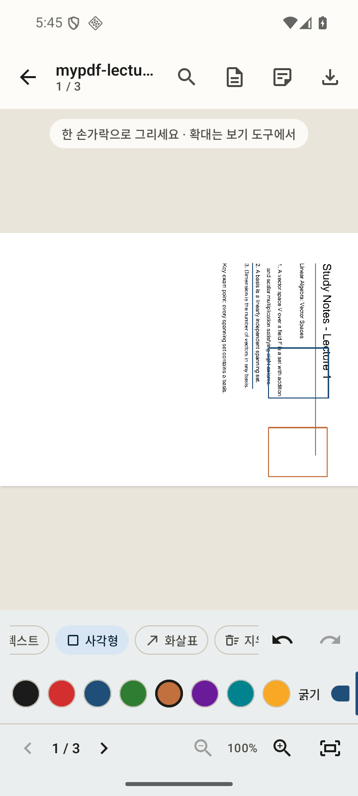
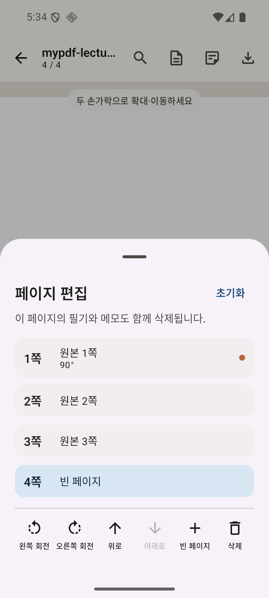
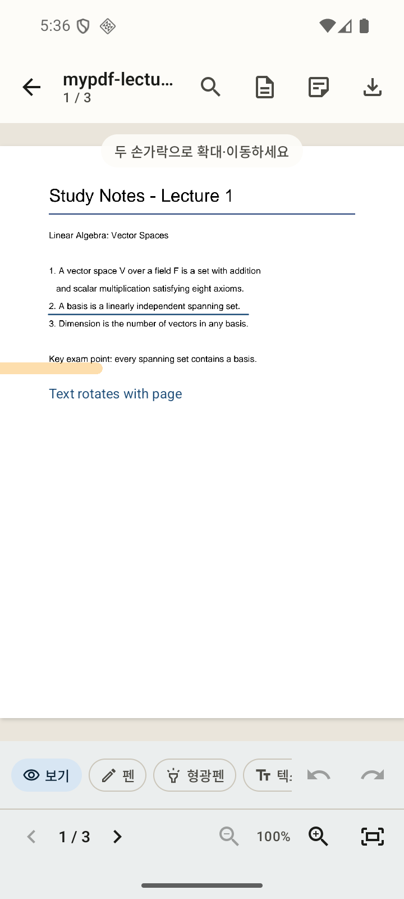
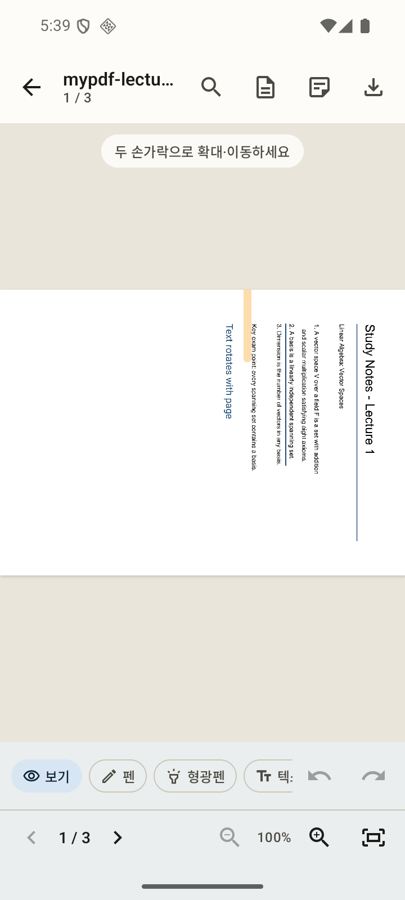

# My PDF Writer

> 전공 공부를 위한 오프라인 PDF 필기·편집 앱

강의자료 PDF 위에 바로 필기하고, 페이지를 정리하고, 주석이 새겨진 PDF로 내보내는 Android 앱입니다.
광고·계정·인터넷 권한 없이 **기기 안에서만** 동작합니다.

- **패키지**: `com.hackerdjakodjo.mypdfwriter`
- **버전**: `0.8.3` (개발 빌드)
- **지원 OS**: Android 8.0 (API 26) 이상
- **타깃 SDK**: 36 (Android 16)

---

## 왜 만들었나

PDF 리더·편집기는 이미 넘쳐나지만, 대학생이 **전공 강의자료를 공부하는 흐름**에 맞춘 앱은 드뭅니다.
대부분은 스캐너·변환기·광고 수익 모델이 앞세워져 있고, 정작 강의자료 위에 빠르게 필기하고
페이지를 정리해 다시 PDF로 내보내는 일은 여러 앱을 오가야 합니다.

My PDF Writer는 다음 한 가지에 집중합니다.

> **"강의자료를 열고 → 표시하고 → 정리하고 → 주석이 새겨진 PDF로 바로 내보낸다."**

---

## 주요 기능

| 영역 | 기능 |
| --- | --- |
| 노트 홈 | 이어서 읽기/쓰기 카드, PDF 열기·새 노트·PDF 도구·백업 빠른 실행, StarNote 스타일 라이브러리, PDF/태그 탭, 검색, 폴더·태그 필터, 즐겨찾기·휴지통 |
| 노트북 | 11종 종이 템플릿(백지·줄·모눈·점·코넬·체크리스트·4분면·독서·회의·플래너·오선지), 커버 색/패턴 |
| 노트 편집 | 필기 보정, 도형 자동 인식, 부분 지우개, 올가미 이동·확대·회전·복사/붙여넣기, 하단 도구 독·스타일 시트, undo/redo |
| 입력 방식 | 스타일러스 필기 + 손가락 이동/확대, 손가락 필기 모드, 줌 잠금 |
| 펜 | 볼펜·만년필·붓·연필 렌더링, 펜박스 프리셋 저장/적용/이름변경 |
| 올가미 | 자유/사각 올가미, 선택 삭제·복제·색 변경, 이동·확대·회전·복사/붙여넣기 |
| 레이어 | 페이지별 레이어 추가·이름변경·숨김·잠금·투명도·순서 |
| 페이지 | 페이지 사이드바, 추가·복제·삭제·순서 이동, 템플릿 일괄/현재 페이지 적용, 노트 PDF 내보내기 |
| 북마크 | 페이지 아웃라인, 페이지 북마크 추가·이름변경·이동·삭제 |
| 읽기 모드 | 단일 페이지, 세로 연속 보기, 2/4페이지 스프레드, 팝업 페이지, 마지막 페이지/진행률 복원 |
| Reflow | PDF 텍스트를 화면 폭에 재배치, 글자 크기·줄 간격·종이/세피아/다크, 텍스트 선택·복사 |
| 읽어주기 | 시스템 TTS로 페이지 읽기, 속도·한국어/English, 페이지 자동 넘김 |
| 텍스트 선택 | PDF 캔버스에서 단어/줄 드래그 선택, 복사, Google 번역, 발췌, 형광펜·밑줄·취소선 |
| 발췌·번역 | PDF 발췌 저장, 발췌 목록/페이지 이동, **Google 번역** 앱/웹으로 바로 열기, 공유 |
| 스터디 노트 | 발췌를 원본 PDF 페이지 링크가 있는 노트북으로 만들기, 선택 텍스트/발췌 드래그 앤 드롭 |
| 오디오 노트 | 로컬 녹음·재생, 페이지 마커 추가/이동 |
| 오디오 재생 | 녹음 위치에 맞춰 당시 필기/도형을 점 단위로 나타내는 리플레이 |
| 로컬 백업 | 노트북·필기·발췌·읽기 진행률·오디오를 ZIP으로 백업/복원, PDF 원본 포함 선택 |
| 필기 | 펜, 형광펜, 텍스트, 사각형, 화살표, 선, 타원, 밑줄, 취소선, 지우개 |
| 스탬프 | APPROVED / DRAFT / CONFIDENTIAL / REVIEWED / 사용자 문구 |
| 서명 | 손글씨 느낌의 서명 텍스트를 페이지에 배치 |
| 가림 | REDACT 검은 박스. 내보낼 때 해당 페이지를 래스터화해 원본 텍스트도 제거 |
| 스타일 | 8색 팔레트, 굵기·글자 크기·투명도 |
| 편집 | 실행 취소 / 다시 실행 (필기와 페이지 작업, 최대 60단계) |
| 페이지 | 썸네일 그리드, 다중 선택, 회전·삭제·복제·이동·빈 페이지·추출 |
| 문서 도구 | PDF 합치기, N쪽마다 분할, 이미지→PDF, PDF→PNG, 텍스트 추출, 최적화 |
| OCR | 한국어/English 온디바이스 OCR, 텍스트 추출, 보이지 않는 텍스트 레이어가 있는 검색 가능한 PDF |
| 보안·정보 | 문서 정보 편집, 열기 암호 설정/해제, 워터마크, 페이지 번호 |
| 읽기 | 목차(북마크), 문서 정보, 야간 모드, 현재 페이지 텍스트 복사, 주석 숨김/필터 패널 |
| 양식 | AcroForm 텍스트·체크박스·라디오·목록 필드 채우기 |
| 메모 | 페이지별 공부 메모, 메모가 있는 페이지 목록 |
| 검색 | PDF 텍스트 검색, 페이지별 결과 수·스니펫, 해당 페이지로 이동, 페이지 위 검색어 하이라이트 |
| 내보내기 | 화면과 동일한 렌더러로 주석·워터마크·페이지 번호를 평탄화해 PDF 저장 |
| 공유·인쇄 | Android 공유 시트와 인쇄 프레임워크 |
| 파일 | SAF로 열기/저장, 최근 문서 목록, 다른 앱에서 PDF 열기(`ACTION_VIEW`) |
| UI | 한국어, 라이트/다크, 엣지투엣지, 빨간 PDF 런처 아이콘, 뷰어 PDF 허브·하단 도구 독·플로팅 페이지 pill, 노트 스타일 시트, 홈 이어서/빠른 실행 |

### 설계 포인트

- **완전 오프라인**: `INTERNET` 권한 자체를 선언하지 않습니다. 광고·분석·계정 SDK도 없습니다.
- **WYSIWYG 내보내기**: 화면 필기와 내보내기가 **같은 `AnnotationPainter`** 를 사용합니다.
  한국어 텍스트, 형광펜 투명도, 펜 곡선이 PDF 뷰어에서도 동일하게 보입니다.
- **회전해도 필기가 따라감**: 페이지를 회전하면 필기 좌표·굵기·글자 크기·텍스트 방향을 함께 보정합니다.
- **원본 보존**: 원본 PDF는 앱 저장소에 복사해 두고, 페이지 구성은 `PageSpec` 목록으로 관리합니다.
  작업용 PDF는 페이지 작업 때마다 원본에서 다시 조립합니다.
- **StarNote-like 노트 워크플로**: 공개 스토어 스크린샷과 사용자 제공 APK의 리소스/매니페스트를 정적 분석해
  홈·태그/폴더·템플릿·페이지 사이드바·스타일러스 모드의 흐름만 참고했습니다. StarNote의 코드·템플릿 SVG·커버·로고·
  브랜딩은 복제하지 않았습니다. 분석 기록: [`docs/starnote-reverse-engineering.md`](docs/starnote-reverse-engineering.md)
- **한 손 UX**: 뷰어는 하단 도구 독·플로팅 페이지 pill·PDF 허브로, 노트는 하단 도구 독·스타일 시트로
  주요 동작을 엄지 범위에 모았습니다. 상세 매핑: [`docs/ux-overhaul.md`](docs/ux-overhaul.md)
- **온디바이스 OCR**: ML Kit 한국어/English 모델을 APK에 포함합니다. `INTERNET` 권한은
  라이브러리가 추가한 것까지 매니페스트에서 제거해, OCR도 완전히 오프라인으로 동작합니다.
- **검색 가능한 PDF**: OCR 결과를 PDFBox의 보이지 않는 텍스트 레이어(`RenderingMode.NEITHER`)로
  넣어 스캔 PDF에서도 검색·복사가 가능합니다. 원본 페이지는 이미지로 평탄화됩니다.

---

## 스크린샷

| 홈 | 필기 | 페이지 편집 |
| --- | --- | --- |
|  |  |  |

| 회전된 페이지 | 도형 | 형광펜 |
| --- | --- | --- |
|  |  |  |

| 페이지 메모 | 검색 | 빈 페이지 |
| --- | --- | --- |
|  |  |  |

| 초기화 | 내보내기 | 내보낸 PDF 열기 |
| --- | --- | --- |
|  |  |  |

> Pixel 7 AVD(Android 16)에서 720×1600으로 캡처했습니다. 일부 화면은 0.8.1 UX 개편 전 UI이며, 문서는 테스트용 샘플 PDF입니다.

---

## 사용 흐름

1. 홈의 **이어서 읽기** 카드 또는 **PDF 열기**로 강의자료를 엽니다. 새 노트는 **새 노트**에서 바로 시작합니다.
2. 뷰어 하단의 도구 독에서 펜·형광펜·텍스트·도형·지우개를 고릅니다.
3. 색·굵기·투명도는 **스타일** 시트에서 한 번에 조정하고 페이지 위에 표시합니다.
4. 페이지 이동은 하단의 `‹ 3 / 12 ›` pill을, 페이지 정리·검색·읽기 모드·내보내기는 상단의 **PDF 허브**를 사용합니다.
5. 노트 에디터도 하단 도구 독과 **스타일** 시트로 필기하고, 레이어·오디오·아웃라인은 상단 **더보기**에서 엽니다.
6. **PDF 허브 → PDF 내보내기**로 `원본이름_주석.pdf`를 저장합니다. 주석은 PDF에 평탄화되어 어디서나 동일하게 보입니다.

---

## 기술 스택

| 구분 | 사용 기술 |
| --- | --- |
| 언어 | Kotlin 2.2.21 |
| UI | Jetpack Compose (BOM 2025.12.01, Material 3) |
| 빌드 | AGP 8.13.2, Gradle 8.13, JDK 17 |
| PDF 읽기/조립 | PDFBox-Android 2.0.27.0 |
| PDF 화면 렌더링 | `android.graphics.pdf.PdfRenderer` |
| 상태 관리 | `ViewModel` + `StateFlow` (단일 모듈, Navigation/Room/Hilt 미사용) |
| 저장 | `org.json` 기반 JSON 파일 + `SharedPreferences` |
| 파일 접근 | Storage Access Framework (`ActivityResultContracts`) |

**빌드 크기**: **arm64 디버그 약 44 MB(기본 배포)**, universal 디버그 약 72 MB,
R8 릴리스 약 51 MB(전체 ABI).
ML Kit OCR 모델·한국어 폰트가 APK에 포함되어 이전 버전보다 커졌습니다. R8 코드/리소스 축소 적용.

**APK 차이**: arm64 APK는 `lib/arm64-v8a` 네이티브 라이브러리만 포함합니다.
universal APK는 arm64·32-bit ARM·x86·x86_64 라이브러리를 모두 넣은 같은 앱이라
최신 arm64 폰에서는 기능 차이가 없고 용량만 커집니다. 기본 배포는 arm64 전용이며,
32-bit ARM 폰이나 x86 에뮬레이터에서만 universal이 필요합니다.

---

## 아키텍처

```
[홈 / 라이브러리]
      │ SAF OpenDocument
      ▼
[PdfViewModel] ── 원본 PDF 복사 ──▶ files/sources/<docId>.pdf
      │                                  │
      │ PageSpec 목록                    │ assemble()
      ▼                                  ▼
[작업용 PDF] ◀──────────────── cache/working/<docId>.pdf
      │ PdfRenderer
      ▼
[페이지 비트맵] + [AnnotationPainter 오버레이]
      │
      ├─ 필기/도형/텍스트 → Annotation(정규화 좌표) → docstates/<docId>.json
      └─ 내보내기 → PdfExporter(2x 래스터 + 회전 행렬) → SAF 저장
```

- 좌표는 페이지 표시 영역 기준 **0.0~1.0 정규화 좌표**로 저장합니다.
- 페이지 작업(회전·이동·삭제·빈 페이지)은 `PageSpec`만 바꾸고 작업용 PDF를 다시 조립합니다.
- 자세한 설계와 회전 보정 수식은 [`docs/architecture.md`](docs/architecture.md)를 참고하세요.

---

## 빌드 및 실행

### 요구 사항

- JDK 17
- Android SDK Platform 36, Build-Tools 36
- Android Studio (권장) 또는 커맨드라인

### 로컬 빌드

```bash
# 1) 저장소 클론
git clone https://github.com/hackerdjaKODJO/my-pdf-writer.git
cd my-pdf-writer

# 2) SDK 경로 지정 (local.properties는 커밋되지 않습니다)
#    Windows 예: sdk.dir=C\:\\Users\\<user>\\AppData\\Local\\Android\\Sdk
#    macOS/Linux 예: sdk.dir=/Users/<user>/Library/Android/sdk

# 3) 디버그 빌드 (기본: arm64 전용, 작은 APK)
./gradlew assembleDebug -Parm64Only=true   # Windows: gradlew.bat assembleDebug -Parm64Only=true

# 4) 설치
adb install -r app/build/outputs/apk/debug/app-arm64-v8a-debug.apk
```

디버그 빌드는 `applicationIdSuffix = ".debug"`가 붙어
`com.hackerdjakodjo.mypdfwriter.debug`로 설치됩니다.

### 릴리스 빌드

R8 코드 축소와 리소스 축소가 켜져 있습니다(`app/build.gradle.kts`).
PDFBox-Android의 선택적 클래스에 대한 keep/dontwarn 규칙은 `app/proguard-rules.pro`에 있습니다.
업로드 키스토어와 `keystore.properties`는 저장소에 커밋하지 않습니다.

```bash
# 새 환경에서 업로드 키 생성 (비밀번호는 안전한 곳에 보관)
keytool -genkeypair -v -keystore upload-keystore.jks -storetype PKCS12 \
  -alias upload -keyalg RSA -keysize 2048 -validity 10000

# keystore.properties
# storeFile=upload-keystore.jks
# storePassword=...
# keyAlias=upload
# keyPassword=...

./gradlew bundleRelease assembleRelease
# app/build/outputs/bundle/release/app-release.aab
# app/build/outputs/apk/release/app-release.apk
```

릴리스 APK는 `com.hackerdjakodjo.mypdfwriter`(디버그 접미사 없음)로 설치됩니다.

---

## 검증 기록

Android 16(Pixel 7 AVD)에서 다음 흐름을 직접 확인했습니다.

- PDF 열기, 최근 문서 등록/제거, 빈 PDF 생성
- 펜·형광펜·텍스트·사각형·화살표·지우개, 색/굵기 변경
- 실행 취소/다시 실행
- 페이지 회전(90°/180°), 이동, 삭제, 빈 페이지 추가, 원본 구성 초기화
- 회전된 페이지에서 텍스트·밑줄·형광펜이 함께 회전
- 페이지 메모 저장/불러오기, 텍스트 검색(2건) 및 페이지 이동
- 디버그 내보내기: `mypdf-lecture_주석.pdf` (24,982 bytes)
  - `pdfinfo`: 3 pages, A4, Page rot 90
  - Poppler 렌더링으로 평탄화된 필기·형광펜·밑줄 확인
  - 내보낸 PDF를 앱에서 다시 열어 편집 가능한 주석이 없음을 확인
- **R8 릴리스 APK**에서 PDF 열기, 펜, 검색(2건), 페이지 회전, 내보내기 재검증
  - `release-r8-test.pdf` (14,545 bytes), `pdfinfo`: 3 pages, A4, Page rot 90
- **단위 테스트 214개 통과** (페이지 회전/정규화, 주석 JSON, 노트북/레이어/북마크, 펜박스/올가미,
  발췌 JSON, OCR 범위, 페이지 정리 등)
- 릴리스 APK 권한 확인: `INTERNET`/저장소/카메라/알림/광고 ID 없음
- 네이티브 라이브러리 16 KB 페이지 정렬 확인 (`zipalign -c -P 16`)
- 노트 다중 획 E2E 테스트 2개를 `assembleDebugAndroidTest`로 컴파일 (실기기 실행은 adb 기기 연결 후)
- Flexcil 필기 리뷰·기능 매트릭스: [`docs/flexcil-handwriting-review.md`](docs/flexcil-handwriting-review.md)
- E2E 실행 명령: [`docs/testing.md`](docs/testing.md)

> 계측(UI) 테스트는 `app/src/androidTest/`에 추가되어 빌드되지만, 이 환경에는 adb 기기가 없어 실기기 실행은 아직입니다. 위 항목은 JVM 단위 테스트와 빌드 검증 결과입니다.

---

## 개인정보와 권한

- `INTERNET` 권한을 **선언하지 않습니다**. 문서와 필기가 기기 밖으로 나가지 않습니다.
- 광고·분석·계정 SDK가 없습니다.
- 파일은 SAF로 사용자가 직접 선택한 PDF만 읽고, 앱 전용 저장소에 복사합니다.
- 필기·페이지 구성·메모는 앱 전용 JSON(`files/docstates/`)에 저장됩니다.
- 최근 문서 목록은 `SharedPreferences`에 최대 40개까지 저장됩니다.
- 앱을 삭제하면 앱 전용 데이터도 함께 삭제됩니다. (원본 PDF는 삭제되지 않습니다.)
- 개인정보 처리방침: <https://hackerdjakodjo.github.io/my-pdf-writer/privacy-policy.html>

---

## 프로젝트 구조

```
app/src/main/java/com/hackerdjakodjo/mypdfwriter/
├── MainActivity.kt              # SAF 런처, ACTION_VIEW, 홈/뷰어 전환
├── MyPdfWriterApp.kt            # PDFBox 리소스 초기화
├── data/
│   ├── Models.kt                # Annotation, PageSpec, DocState, RecentDoc
│   ├── PageTransforms.kt        # 회전 시 좌표/굵기/글자 크기 보정 (순수 함수)
│   └── Stores.kt                # DocStateStore(JSON), LibraryStore(SharedPreferences)
├── pdf/
│   ├── PdfRepository.kt         # 원본 복사, 페이지 조립, PdfRenderer 캐시, 텍스트 추출
│   ├── AnnotationPainter.kt     # 화면/내보내기 공용 페인터
│   └── PdfExporter.kt           # 주석 평탄화 + 회전 행렬
└── ui/
    ├── LibraryScreen.kt         # 홈, 최근 문서, 기능 소개
    ├── ViewerScreen.kt          # 뷰어 상단/하단 바, 도구 모음
    ├── ViewerSheets.kt          # 페이지/메모/검색 시트, 텍스트 입력
    ├── PdfCanvas.kt             # 제스처, 좌표 변환, 실시간 미리보기
    ├── PdfViewModel.kt          # 상태, 페이지 작업, 실행 취소, 검색, 내보내기
    └── theme/Theme.kt
app/src/test/java/com/hackerdjakodjo/mypdfwriter/data/
├── PageSpecTest.kt              # 회전 정규화
├── PageTransformsTest.kt        # 90/180/270 좌표·스케일 변환
└── DocStateTest.kt              # 원본 변경 시 페이지/주석/메모 재매핑
```

기타:

- `tools/make-sample-pdf.js`, `tools/mypdf-lecture.pdf` — 테스트용 3페이지 샘플
- `docs/flexcil-analysis.md`, `docs/all-pdf-reader-analysis.md` — 경쟁 PDF/노트 앱 정적 분석
- `tools/make-store-assets.py` — Play Store 스크린샷/피처 그래픽/아이콘 생성
- `store/` — Play Store 등록용 1080×2160 스크린샷 7장, 피처 그래픽, 512px 아이콘
- `docs/screenshots/` — 기능 검증 스크린샷
- `docs/competitive-analysis.md` — 경쟁 앱 5종 역공학 분석
- `docs/architecture.md` — 상세 설계
- `docs/play-store-roadmap.md` — Play Store 출시 로드맵

---

## Play Store 자산

`store/`에 Play Store 등록용 자산과 문안을 준비했습니다.

- `store/screenshots/` — 1080×2160 스크린샷 7장 (1:2 비율)
- `store/feature-graphic-1024x500.png` — 피처 그래픽
- `store/icon-512.png` — 앱 아이콘
- `store/README.md` — 앱 이름/설명, 데이터 안전성 답변, 업로드 체크리스트

`python tools/make-store-assets.py`로 언제든 다시 생성할 수 있습니다.

---

## 로드맵

- **v0.1**: 핵심 필기·페이지 편집·메모·검색·평탄화 내보내기, R8 릴리스 빌드/AAB,
  업로드 키스토어, Play Store 자산
- **v0.2**: PDF 작업대 — 페이지 썸네일/다중 선택, 합치기·분할·이미지 변환·텍스트 추출,
  OCR(한국어/English)·검색 가능한 PDF, 암호·메타데이터·워터마크·페이지 번호, 양식,
  목차·야간 모드·인쇄/공유, 스탬프·서명·가림, 페이지 작업 undo/redo
- **v0.3**: StarNote 리버스 엔지니어링 기반 노트 홈·템플릿 노트북 에디터·PDF 탭 통합
- **v0.4**: 올가미 선택, 볼펜/만년필/붓/연필, 펜박스, 레이어, 페이지 북마크/아웃라인, PDF 발췌
- **v0.4.1**: 발췌 번역을 Google 번역 앱/웹으로 바로 연결 (앱 자체는 INTERNET 권한 없음)
- **v0.5.0**: 읽기 진행률/PDF 북마크, 세로 연속 보기, Reflow 텍스트 모드, 시스템 TTS 읽어주기
- **v0.6.0**: PDF 캔버스 텍스트 선택·마크업, 스터디 노트/원본 링크, 2/4페이지 스프레드·팝업, 오디오 노트/페이지 마커
- **v0.7.0**: 스터디 노트 드래그 앤 드롭, 오디오 타임라인 기반 필기 획 리플레이
- **v0.8.0**: 점 단위 필기 애니메이션, 검색 결과 페이지 하이라이트, 로컬 ZIP 백업/복원
- **v0.8.1**: PDF 허브·하단 도구 독·플로팅 페이지 pill, 홈 이어서/빠른 실행, 노트 스타일 시트
- **v0.8.2**: 다중 획 유지 버그 수정, 노트 추적 로그/디버그 시트, 다중 획 E2E 회귀 테스트
- **v0.8.3 (현재)**: Flexcil 필기 리뷰 기반 필기 보정·도형 자동 인식·부분 지우개·올가미 편집/클립보드, PDF 주석 숨김/필터
- **v0.8.4+**: 스터디 노트 분할 패널, 필압 잉크, 검색 결과 다음/이전 이동, 접근성, 백업 암호화, EPUB/Word/PPT는 MyReader와 역할이 겹쳐 보류
- **v1.0**: 사용자 승인 후 Play Store 정식 출시, 영어/일본어 UI, 온보딩

자세한 출시 체크리스트는 [`docs/play-store-roadmap.md`](docs/play-store-roadmap.md)를 참고하세요.

---

## 라이선스

아직 별도 라이선스 파일이 없습니다. 외부 배포 전에 결정이 필요합니다.
사용한 오픈소스 라이브러리의 라이선스(Compose, PDFBox-Android 등)는 각 프로젝트를 따릅니다.
